# Drone traffic analytics for motorbike-heavy Vietnamese streets

A drone video pipeline that detects, tracks, counts and measures traffic in Ho Chi Minh City, built
without annotating a single image by hand. Every reported number is measured on a frozen,
human-labelled test set and comes with a 95 % confidence interval.

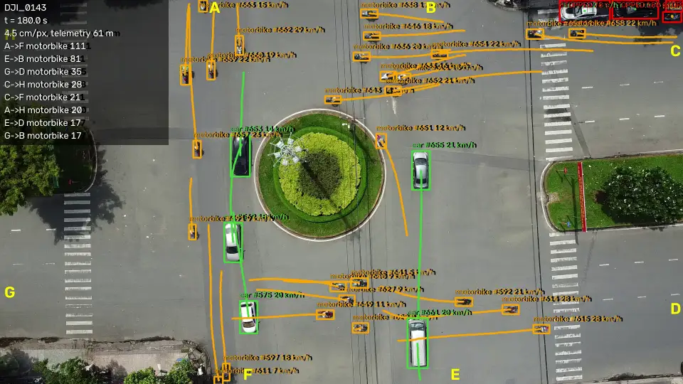

*Traffic analytics at a public roundabout, 61 m above the road: every vehicle carries its class, track
ID and speed in km/h; the junction arms (A–H) are found automatically and the panel counts turning
movements live.*

## Highlights

- **No hand labels.** Two detectors trained on public drone data label 4,000 frames of Vietnamese
  footage; small YOLO11 students learn from those pseudo-labels. On the Vietnamese test set the
  student reaches **66.4 mAP50** [59.8, 74.7] against **57.4** [49.7, 68.0] for the best public
  VisDrone model.
- **Active learning closes the gap to 90 %.** Adding 800 frames picked from an unlabelled pool lifts
  the tiled student to **92.7 AP50 on motorbikes** [87.1, 96.8] and **95.5 on cars** [92.2, 98.2].
- **Real time on a desktop GPU.** TensorRT FP16 runs the 1536-px student at **68 fps** on an RTX 4070,
  2.6 times faster than FP32 at the same accuracy (measured at 1280 px).
- **Tracking and counting.** HOTA **51.0** on VisDrone-MOT and **51.7** on UAVDT; line counts within
  **7.7 %** and **6.4 %** of the ground truth.
- **Click-to-lock follow.** A lock that survives occlusions, with a "virtual gimbal" crop that keeps
  the target centred; on the long UAV20L vehicle sequences re-acquisition lifts success AUC from
  **52.5 to 85.2**.
- **Traffic measurements in real units.** Speeds, turning movements, density and stopped or
  wrong-way vehicles over 95 minutes of video, with the ground scale read from the drone's own flight
  log.
- **Honest reporting.** Settings are fixed before each test run and never tuned on it; results that
  did not work out are reported as such (see [Limitations](#limitations)).

## Demos

**Lock and follow.** Each clip shows the full frame on the left (lock box, crop outline) and the
virtual-gimbal view on the right.

| | | |
|---|---|---|
| 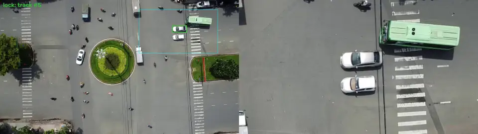 | 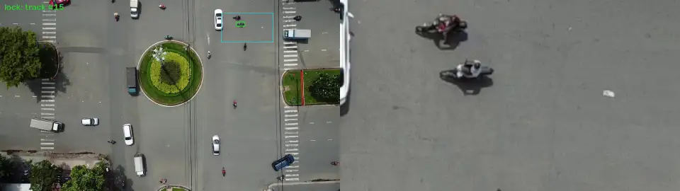 | 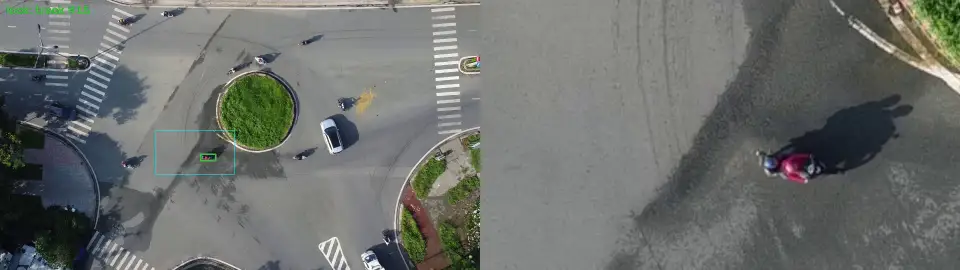 |
| Car around a roundabout | Motorbike between trucks | Motorbike, campus roundabout |
| 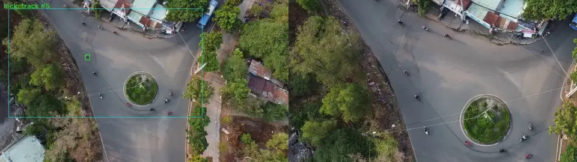 | 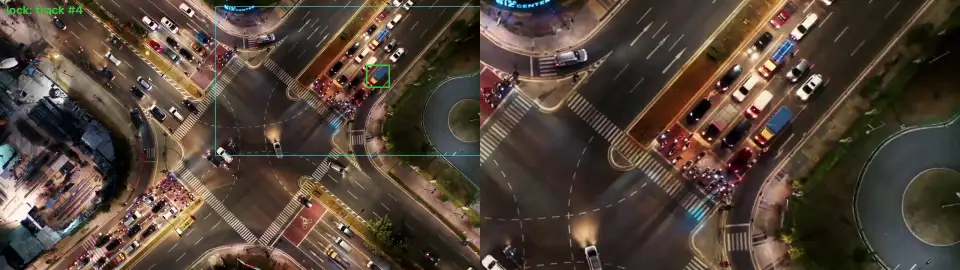 | 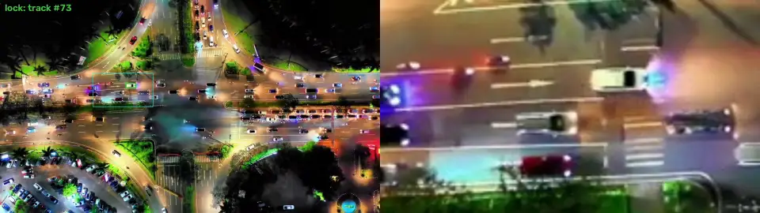 |
| Motorbike at 71 m | Truck through a junction at dusk | Car at night |
| 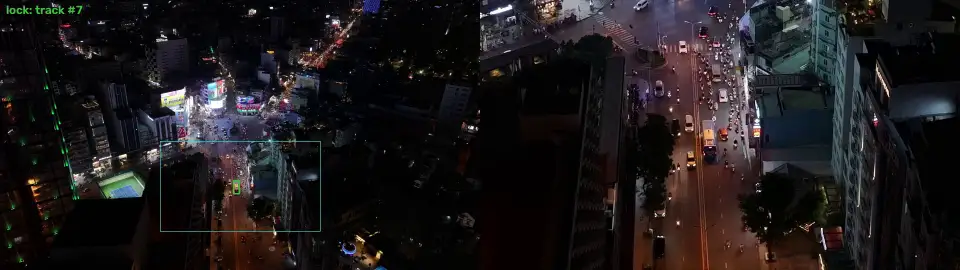 | 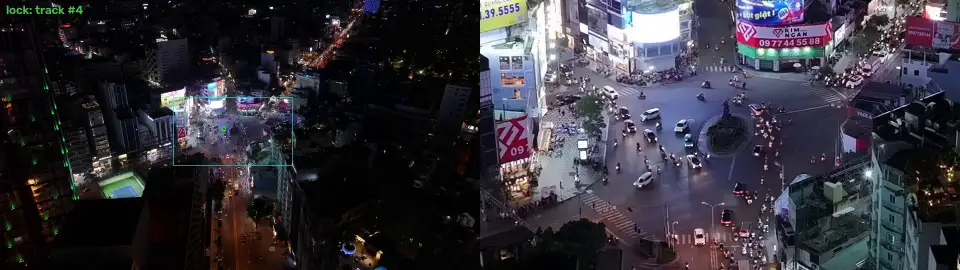 | 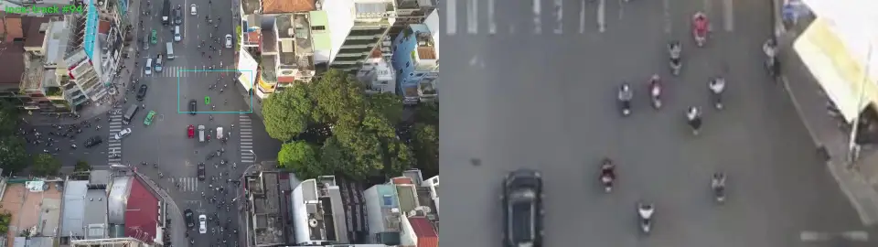 |
| Bus, 4K, moving drone | Car, 4K, moving drone | Motorbike down a long avenue |

**Traffic analytics** at a campus roundabout (51 m):

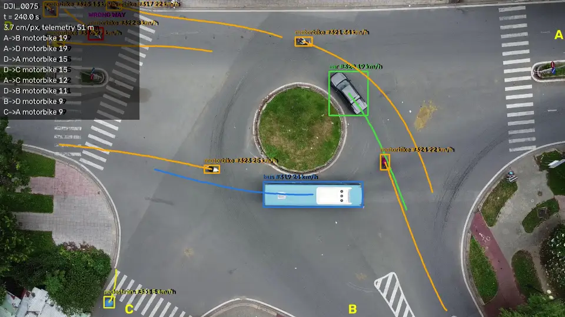

## How it works

1. **Teachers** — YOLO11x and RT-DETR-x trained on VisDrone label Vietnamese drone footage at full
   resolution and in tiles; their boxes are fused and filtered with per-class thresholds tuned on
   VisDrone only.
2. **Students** — YOLO11 n/s/m trained on VisDrone plus the pseudo-labels; active learning then picks
   the most useful frames from an unlabelled pool (labels revealed by a simulated oracle).
3. **Deployment** — TensorRT FP32/FP16/INT8 engines at several input sizes, with a speed–accuracy
   frontier, and batched 640-px tiles for small objects.
4. **Tracking** — ByteTrack and BoT-SORT with camera-motion compensation, tuned on a separate split;
   stabilization to a reference frame for line counting.
5. **Lock and follow** — tracker ID first, an OpenCV MIL fallback, motion-gated re-acquisition, and a
   PD-controlled crop whose commands have the shape of MAVLink gimbal rate control.
6. **Analytics** — flight-log scale, smoothed ground kinematics, automatic junction arms, turning
   counts, speed / density / stationary maps, stopped and wrong-way events.

## Results at a glance

| Capability | Test set | Result | Details |
|---|---|---|---|
| Detection, no hand labels | UIT-Drone7 test (12 clips, HCMC) | 66.4 mAP50 [59.8, 74.7] | [Detection](docs/results.md#results) |
| + active learning, tiled | same | motorbike 92.7, car 95.5 AP50 | [Active learning](docs/results.md#active-learning-on-vietnamese-drone-footage) |
| Speed | RTX 4070, TensorRT FP16, 1536 px | 68 fps | [Deployment](docs/results.md#deployment-tensorrt-latency-vs-accuracy) |
| Tracking | VisDrone-MOT test-dev / UAVDT | HOTA 51.0 / 51.7 | [Tracking](docs/results.md#tracking) |
| Line counting | 8 sequences with counting lines | 7.7 % / 6.4 % total error | [Tracking](docs/results.md#tracking) |
| Lock (re-acquisition) | UAV20L vehicles / UAV123 vehicles | success AUC 85.2 / 73.7 | [Lock and follow](docs/results.md#target-lock-and-virtual-gimbal-follow) |
| Stopped + wrong-way events | UIT-ADrone, 16 clips | AUC 72.5 pooled, 53.8 median per clip | [Analytics](docs/results.md#traffic-analytics-on-full-length-clips) |

All numbers in %, 95 % confidence intervals from a bootstrap over whole clips or sequences. The full
tables, per-class results, ablations and the findings of every stage are in
[docs/results.md](docs/results.md).

## Limitations

- **Event detection works between clips, not within them.** The stopped and wrong-way rules reach
  AUC 72.5 pooled, but the median per-clip AUC is 53.8: they separate busy clips from quiet ones
  rather than finding the abnormal moments. Wrong-way flags alone are at chance (51.3).
- **Speeds are unvalidated.** No measured speeds exist for these clips; detected cars measure about
  5.2 m on the flight-log scale, so speeds may read up to ~15 % high.
- **Turning counts cannot be scored** with the available ground truth (2 and 10 complete trips on the
  test sequences).
- **Pedestrians and bicycles** stay weak (AP50 about 38 and 16–29, with wide intervals) and active
  learning gave no clear gain for them.
- **Lock re-acquisition** raises wrong-target frames (12 % → 18 % on VisDrone-MOT); appearance
  features did not help.
- **Small sets.** Several test sets have 4–20 sequences, so confidence intervals are wide.

## Repository layout

```
cvt/            Python package (CLI: `uv run cvt --help`)
  data/         dataset adapters, manifest, leakage check (pHash), class schema
  detect/       detectors, tiling, box fusion
  pseudo/       pseudo-labelling       train/   time-boxed training jobs
  eval/         mAP / per-slice metrics, bootstrap CIs, report generation
  track/        trackers, camera-motion compensation, stabilization, counting
  deploy/       TensorRT export, latency benchmark, Pareto frontier, tile engines
  al/           active-learning strategies and simulated oracle
  follow/       target lock, virtual gimbal, single-object benchmarks
  analytics/    flight-log scale, kinematics, junction arms, events, maps, overlay
configs/        datasets, models, trackers, thresholds, experiment grids
scripts/        one PowerShell script per stage (each takes -Step and -DryRun)
reports/        results.csv (every reported number) and small tables / figures
docs/           results.md (all tables and findings), img/ (demo clips)
tests/          557 CPU tests on synthetic data (no GPU or datasets needed)
```

## Hardware and runtime

Developed on Windows 11 with one NVIDIA RTX 4070 (12 GB). GPU steps: training, TensorRT export,
detection passes; everything else (tracking, evaluation, analytics) runs on the CPU. As a guide,
detection over the 16 full-length analytics clips (176,000 frames at 1080p) takes about an hour,
and tracking and stabilizing them about three hours on the CPU.

## Installation

Requires [uv](https://docs.astral.sh/uv/), Python 3.12 and, for GPU steps, an NVIDIA driver with CUDA
12.

```bash
uv sync --extra ml            # exact environment from uv.lock (PyTorch, Ultralytics, TensorRT)
uv run --extra ml pytest -q   # CPU test suite (no GPU or datasets needed)
uv run --extra ml cvt --help
```

## Data

Datasets and weights are not redistributed. Download them from their sources into `data/external/`
and `data/weights/` (layout in [configs/datasets.yaml](configs/datasets.yaml));
[configs/checksums.sha256](configs/checksums.sha256) records the files used.

| Dataset | Use | Source |
|---|---|---|
| VisDrone2019-DET / -MOT | teacher training, source-domain test, MOT test | [VisDrone](https://github.com/VisDrone/VisDrone-Dataset) |
| UIT-Drone7 | Vietnamese detection test (T-VN); active-learning pool | [Zenodo](https://zenodo.org/records/14864411) |
| UIT-ADrone | pseudo-label pool; analytics clips and anomaly labels | [UIT-ADrone](https://uit-together.github.io/datasets/UIT-ADrone/) |
| UAVDT (MOT, SOT) | MOT test, lock benchmark | [UAVDT](https://sites.google.com/view/grli-uavdt) |
| UAV123 / UAV20L | lock benchmark (vehicle sequences) | [UAV123](https://cemse.kaust.edu.sa/ivul/uav123) |
| VisDrone YOLO11 weights | zero-shot baselines | [dronefreak](https://github.com/dronefreak/VisDrone-dataset-python-toolkit) |

## Reproducing the results

Each stage is one script; `-DryRun` prints its commands, `-Step` runs one part. GPU steps are marked
in each script's header.

```powershell
uv run cvt manifest build ; uv run cvt leakage check          # dataset manifest, near-duplicate check
scripts\eval_baselines.ps1 -Sets "T-VD,T-VN"                   # public VisDrone baselines
scripts\train.ps1 -Group teachers ; scripts\audit_teachers.ps1 # teachers and their audit
scripts\pseudolabel.ps1 ; scripts\train.ps1 -Group students    # pseudo-labels, students
scripts\eval_students.ps1                                      # students on the frozen test sets
scripts\deploy.ps1 ; scripts\tiles.ps1                         # TensorRT engines and benchmarks
scripts\al.ps1                                                 # active learning
scripts\track.ps1 ; scripts\track3b.ps1                        # tracking and counting
scripts\follow.ps1                                             # lock and virtual-gimbal follow
scripts\analytics.ps1                                          # traffic analytics
uv run cvt report                                              # regenerates docs/results.md
```

Every number lands in `reports/results.csv`; `cvt report` rebuilds the tables in `docs/results.md`
from it.

## Future directions

- **Serving:** live RTSP feeds, an API and a dashboard around the same pipeline.
- **Multi-drone tracking:** keeping vehicle identities across two drones (MDMT, M3OT).
- **Simulation and real flight:** the tracker as a ROS 2 node in PX4 / Gazebo, then on a Jetson-class
  computer aboard one drone, with the follow commands driving a real gimbal.
- **Event-level anomaly labels** to evaluate events where they happen, and the dataset's other
  violation types.
- **Measured speeds** (a surveyed distance or GNSS-equipped vehicles) to validate the speed scale.

## Footage and credits

The analytics clips and four of the follow demos come from UIT-ADrone (T. M. Tran, T. N. Vu, T. V.
Nguyen and K. Nguyen, "UIT-ADrone: A Novel Drone Dataset for Traffic Anomaly Detection", IEEE
JSTARS, 2023).

## Citation

If you use this code, please cite it with the metadata in [CITATION.cff](CITATION.cff) (GitHub's
"Cite this repository" button).

## License

Code: GNU AGPL-3.0, see [LICENSE](LICENSE) (the pipeline builds on Ultralytics, which is AGPL-3.0).
Datasets, weights and footage are not part of the licence.
