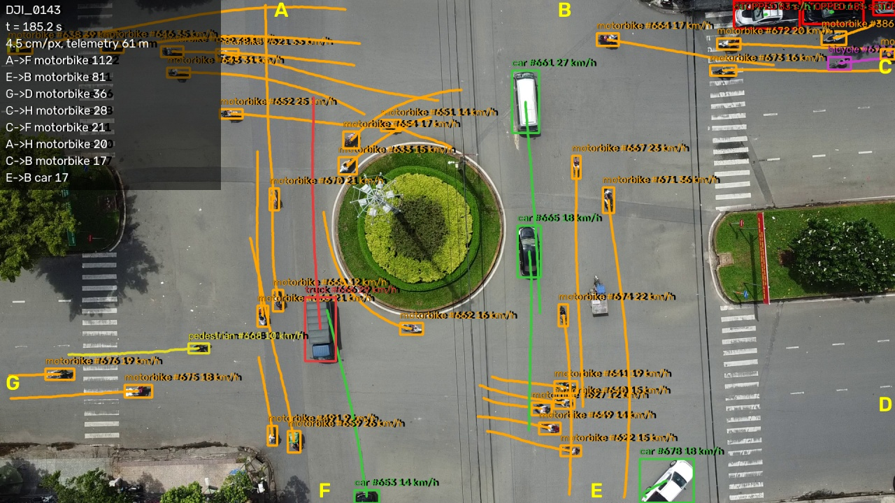
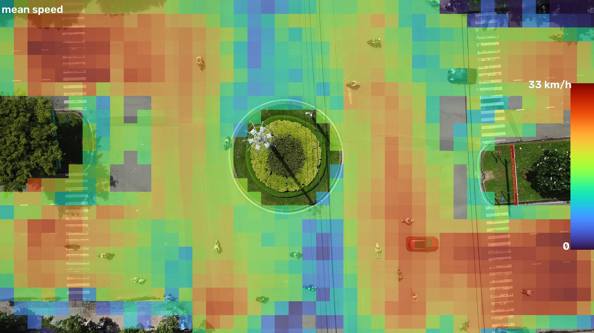
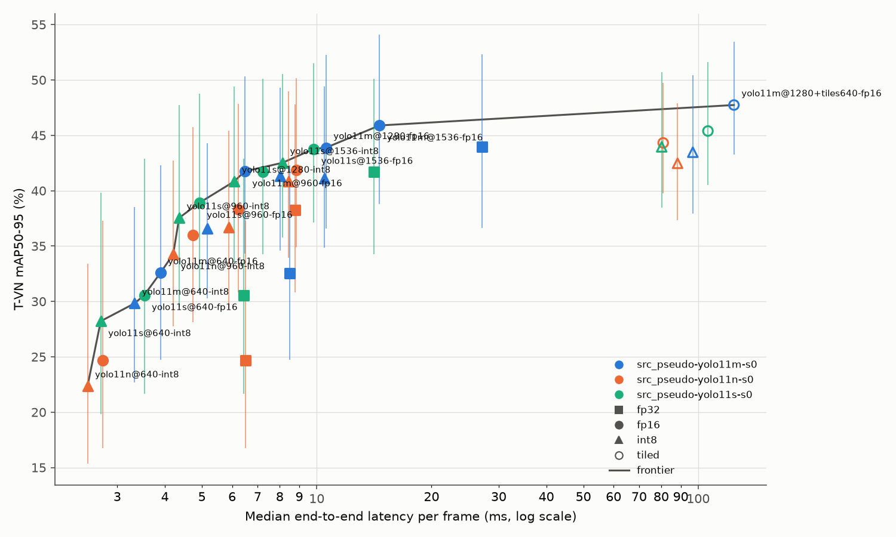
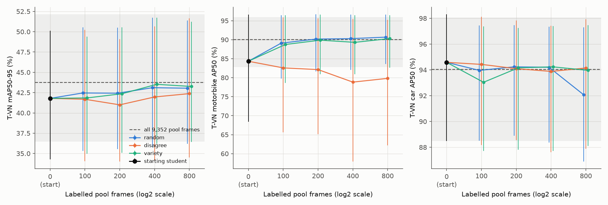
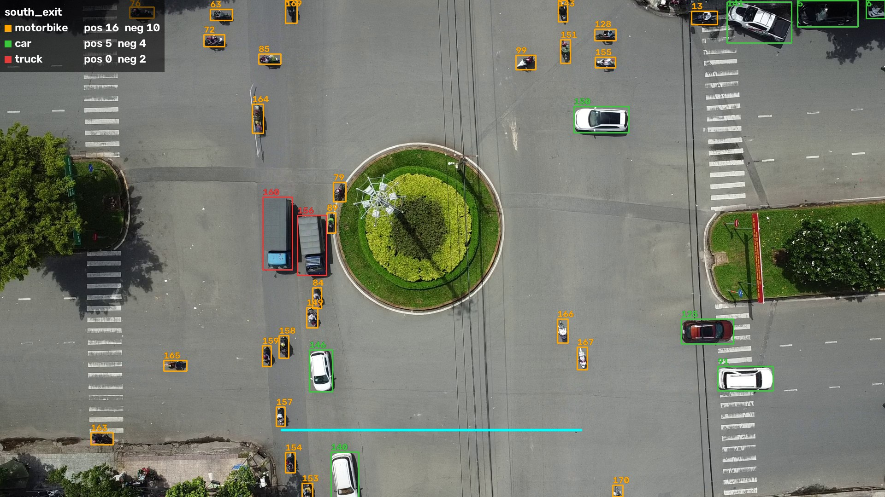

# Results and findings

The full evidence behind the [README](../README.md): every table below is generated by `uv run cvt report` from `reports/results.csv` (do not edit the marked blocks by hand), followed by the findings of each stage, newest first. Numbers are in %, with 95% confidence intervals in brackets from a cluster bootstrap over whole clips or sequences.

## Results

Generated by `cvt report` from `reports/results.csv` — do not edit by hand.

T-VD = VisDrone2019-DET val (548 images, 76 sequences) in our 6-class schema (van→car, people→pedestrian, tricycles ignored, riders merged into their two-wheeler); numbers are therefore not comparable to published 10-class VisDrone results. T-VN = UIT-Drone7 test (5,950 frames, 12 clips, Ho Chi Minh City), never used for training or tuning.

<!-- results:start -->
| model | imgsz | T-VD mAP50 | T-VD mAP50_95 | T-VN mAP50 | T-VN mAP50_95 | VD-tune mAP50 | VD-tune mAP50_95 |
|---|---|---|---|---|---|---|---|
| dronefreak-yolo11n | 640 | 34.4 [31.1, 37.4] | 19.8 [17.5, 21.9] | 32.2 [23.9, 42.2] | 20.2 [13.7, 29.4] | – | – |
| dronefreak-yolo11n | 1280 | 54.9 [50.9, 57.8] | 33.5 [30.7, 35.7] | 51.9 [45.4, 60.8] | 35.3 [29.4, 43.2] | – | – |
| dronefreak-yolo11s | 640 | 40.4 [37.5, 43.1] | 24.2 [22.0, 26.2] | 34.9 [26.1, 46.1] | 23.3 [16.1, 33.6] | – | – |
| dronefreak-yolo11s | 1280 | 61.6 [57.9, 64.3] | 38.9 [36.1, 41.1] | 51.8 [43.5, 63.0] | 36.0 [29.4, 44.2] | – | – |
| dronefreak-yolo11x | 640 | 52.4 [48.6, 55.3] | 32.4 [29.5, 34.6] | 48.2 [42.2, 57.1] | 32.2 [27.3, 39.3] | – | – |
| dronefreak-yolo11x | 1280 | 62.7 [58.3, 65.8] | 39.2 [36.2, 41.5] | 57.4 [49.7, 68.0] | 38.9 [33.2, 47.5] | – | – |
| pseudo-yolo11m-s0 | 1280 | 8.8 [7.6, 10.4] | 5.5 [4.7, 6.7] | 38.1 [21.3, 56.2] | 28.1 [14.8, 42.9] | – | – |
| pseudo-yolo11n-s0 | 1280 | 8.1 [7.0, 9.4] | 4.9 [4.2, 5.9] | 30.2 [17.0, 45.1] | 21.5 [11.6, 33.0] | – | – |
| pseudo-yolo11s-s0 | 1280 | 8.7 [7.6, 10.6] | 5.5 [4.7, 6.7] | 38.2 [21.8, 54.1] | 28.1 [15.1, 41.7] | – | – |
| src-yolo11m-s0 | 1280 | 65.9 [62.7, 68.6] | 42.7 [40.2, 44.8] | 59.3 [52.3, 68.4] | 41.6 [35.2, 49.0] | – | – |
| src-yolo11n-s0 | 1280 | 52.5 [48.6, 55.5] | 32.3 [29.6, 34.4] | 50.6 [43.1, 60.2] | 34.9 [28.6, 42.8] | – | – |
| src-yolo11s-s0 | 1280 | 60.2 [56.2, 63.1] | 38.1 [35.2, 40.3] | 54.9 [48.6, 63.5] | 38.0 [32.0, 44.7] | – | – |
| src-yolo11s-s1 | 1280 | 60.9 [56.9, 64.2] | 38.4 [35.7, 40.7] | 56.7 [50.5, 64.8] | 38.9 [32.7, 46.5] | – | – |
| src-yolo11s-s2 | 1280 | 60.5 [56.6, 63.5] | 38.3 [35.4, 40.5] | 57.3 [50.0, 67.0] | 39.9 [33.0, 47.7] | – | – |
| src_pseudo-yolo11m-s0 | 1280 | 65.3 [61.9, 67.8] | 42.0 [39.3, 44.0] | 63.3 [56.0, 72.5] | 44.0 [36.7, 52.5] | – | – |
| src_pseudo-yolo11n-s0 | 1280 | 52.2 [48.3, 55.2] | 32.1 [29.4, 34.2] | 53.7 [45.7, 64.3] | 38.4 [31.0, 47.4] | – | – |
| src_pseudo-yolo11s-s0 | 1280 | 59.9 [55.8, 63.1] | 37.7 [34.9, 40.0] | 59.8 [52.5, 68.7] | 41.8 [34.3, 50.1] | – | – |
| src_pseudo-yolo11s-s1 | 1280 | 60.4 [56.6, 63.3] | 38.1 [35.4, 40.4] | 57.7 [50.1, 68.3] | 40.5 [33.6, 49.9] | – | – |
| src_pseudo-yolo11s-s2 | 1280 | 59.9 [55.9, 62.8] | 37.8 [34.9, 40.0] | 58.1 [50.7, 68.4] | 40.7 [33.6, 49.6] | – | – |
| teacher-fused | 1280 | 70.8 [67.9, 73.2] | 45.6 [43.1, 47.6] | 73.6 [71.0, 77.0] | 50.2 [45.4, 56.3] | 69.0 [65.0, 73.0] | 41.5 [38.3, 46.2] |
| teacher-rtdetrx | 1280 | 68.7 [65.9, 71.0] | 44.1 [41.7, 46.1] | 67.5 [60.8, 76.4] | 46.6 [39.4, 54.9] | 68.3 [63.8, 73.4] | 41.3 [37.7, 46.6] |
| teacher-rtdetrx-tiled | 1280 | 68.9 [65.8, 71.2] | 43.7 [41.3, 45.8] | 71.8 [67.9, 76.9] | 49.0 [43.9, 54.5] | 67.7 [63.7, 72.0] | 40.6 [37.3, 45.5] |
| teacher-yolo11x | 1280 | 65.5 [62.0, 68.1] | 42.5 [39.7, 44.6] | 61.3 [54.7, 69.5] | 42.4 [35.8, 50.2] | 62.0 [56.7, 68.0] | 37.5 [34.0, 43.0] |
| teacher-yolo11x-tiled | 1280 | 66.9 [63.6, 69.7] | 43.3 [40.6, 45.5] | 68.6 [65.1, 72.2] | 46.9 [43.1, 52.5] | 64.8 [60.5, 69.5] | 39.4 [36.1, 44.1] |

- T-VD: mAP over motorbike,car,bus,truck,bicycle,pedestrian
- T-VN: mAP over motorbike,car,bus,truck,bicycle,pedestrian
- VD-tune: mAP over motorbike,car,bus,truck,bicycle,pedestrian

mAP in %, 95% CI in brackets from a cluster bootstrap over whole clips/sequences. With few clips (see n_scenes in reports/results.csv) the CIs are approximate.
<!-- results:end -->

### Paired comparisons

<!-- compare:start -->
| a | b | T-VD mAP50_95 | T-VD AP50_95/motorbike | T-VD AP50_95/pedestrian | T-VD AP50_95/bicycle | T-VN mAP50_95 | T-VN AP50_95/motorbike | T-VN AP50_95/pedestrian | T-VN AP50_95/bicycle | VD-tune mAP50_95 | VD-tune AP50_95/motorbike | VD-tune AP50_95/pedestrian | VD-tune AP50_95/bicycle |
|---|---|---|---|---|---|---|---|---|---|---|---|---|---|
| pseudo-yolo11s-s0@1280 | vs src-yolo11s-s0@1280 | -32.6 [-34.6, -29.3] | -24.6 [-26.3, -23.0] | -29.8 [-32.4, -27.5] | -14.7 [-17.2, -12.2] | -9.9 [-17.4, -1.9] | +2.1 [-5.7, +9.0] | -0.7 [-4.8, +1.9] | -2.1 [-6.7, -0.4] | – | – | – | – |
| src-yolo11s-s0@1280 | vs dronefreak-yolo11s@1280 | -0.8 [-2.1, -0.0] | +2.8 [+1.7, +3.8] | -0.2 [-0.6, +0.3] | -0.3 [-1.8, +1.0] | +2.1 [+0.1, +3.1] | +5.8 [+2.3, +8.0] | -0.5 [-4.0, +3.0] | +1.5 [+0.1, +4.7] | – | – | – | – |
| src_pseudo-yolo11s-s0@1280 | vs src-yolo11s-s0@1280 | -0.4 [-1.4, +0.4] | -0.3 [-0.9, +0.3] | -0.4 [-0.7, -0.1] | +0.2 [-0.9, +1.2] | +3.7 [+0.9, +6.8] | +8.4 [+4.2, +13.3] | +3.4 [+1.0, +4.9] | -0.3 [-3.4, +0.5] | – | – | – | – |
| src_pseudo-yolo11s-s1@1280 | vs src-yolo11s-s1@1280 | -0.3 [-0.8, +0.3] | +0.0 [-0.6, +0.5] | +0.1 [-0.5, +0.7] | -0.3 [-1.1, +0.4] | +1.6 [+0.3, +4.5] | +5.8 [+3.9, +7.8] | +1.7 [-1.4, +4.0] | -0.4 [-1.3, +1.1] | – | – | – | – |
| src_pseudo-yolo11s-s2@1280 | vs src-yolo11s-s2@1280 | -0.4 [-1.3, +0.3] | -0.1 [-0.7, +0.3] | -0.6 [-0.9, -0.3] | -0.7 [-1.7, +0.3] | +0.8 [-0.9, +3.4] | +4.6 [+3.0, +6.0] | +4.2 [-0.0, +7.9] | +0.3 [-2.5, +3.2] | – | – | – | – |
| teacher-fused@1280 | vs teacher-rtdetrx-tiled@1280 | – | – | – | – | – | – | – | – | +1.0 [+0.4, +1.6] | +1.5 [-0.2, +1.9] | +0.4 [-0.4, +0.6] | +0.4 [-0.3, +1.3] |
| teacher-fused@1280 | vs teacher-yolo11x-tiled@1280 | – | – | – | – | – | – | – | – | +2.2 [+1.8, +2.4] | +2.4 [+1.4, +2.7] | +0.3 [-0.3, +1.1] | +2.1 [+1.2, +2.9] |
| teacher-yolo11x-tiled@1280 | vs teacher-yolo11x@1280 | – | – | – | – | +4.5 [+1.1, +7.4] | +5.4 [+2.6, +7.3] | +1.4 [-1.0, +3.2] | +5.2 [-0.1, +10.8] | +1.9 [+0.4, +3.1] | +3.4 [+0.8, +4.3] | +1.3 [-0.3, +1.9] | +0.7 [-0.3, +1.8] |

Δ in points (a − b); 95% paired cluster-bootstrap CI over clips.
<!-- compare:end -->

### Tracking

Detector `src_pseudo-yolo11s-s0` (full frame, 1280 px, cached detections) with Ultralytics ByteTrack and
BoT-SORT (camera-motion compensation); tracker settings come from a pre-declared grid tuned on MOT-tune
(VisDrone2019-MOT val) only. T-MOT = VisDrone2019-MOT test-dev (14 of 17 sequences, all six classes),
T-UAVDT = UAVDT test (car, truck, bus). `scripts/track.ps1` reproduces every number; the per-cell line
counts behind the counting columns are in `reports/counts_<model>+<tracker>.csv` (`cvt track counts`).

<!-- tracking:start -->
| model+tracker | T-MOT HOTA | T-MOT MOTA | T-MOT IDF1 | T-UAVDT HOTA | T-UAVDT MOTA | T-UAVDT IDF1 | T-UAVDT HOTA daylight (12 seq) | T-UAVDT HOTA night (5 seq) | T-UAVDT HOTA fog (3 seq) | T-UAVDT HOTA low_alt (8 seq) | T-UAVDT HOTA medium_alt (10 seq) | T-UAVDT HOTA high_alt (2 seq) | T-MOT count MAE | T-MOT count % err | T-UAVDT count MAE | T-UAVDT count % err | T-MOT count2 % err | T-UAVDT count2 % err |
|---|---|---|---|---|---|---|---|---|---|---|---|---|---|---|---|---|---|---|
| src_pseudo-yolo11m-s0@1536-fp16+botsort-tuned | 49.2 [46.9, 51.6] | 31.1 [21.9, 40.9] | 62.1 [58.7, 65.5] | 49.6 [42.8, 56.9] | 20.4 [-14.8, 45.6] | 64.1 [54.4, 74.7] | 53.8 [45.8, 61.2] | 41.7 [27.2, 62.9] | 42.4 [37.0, 61.5] | 51.2 [41.5, 61.7] | 54.6 [44.9, 62.3] | 34.2 [25.6, 37.0] | 2.9 | 15.9% | 1.3 | 13.7% | 11.4% | 5.4% |
| src_pseudo-yolo11m-s0@1536-fp16+botsort-tuned3b | 51.0 [47.3, 54.4] | 46.5 [40.8, 52.6] | 65.8 [60.8, 70.9] | 51.7 [45.4, 58.8] | 34.2 [9.2, 55.4] | 68.1 [58.8, 78.1] | 56.4 [49.1, 63.0] | 45.9 [30.9, 65.0] | 41.5 [36.1, 61.5] | 54.6 [45.9, 64.4] | 56.9 [48.0, 63.9] | 34.4 [28.2, 36.1] | 4.2 | 23.0% | 1.5 | 15.7% | 12.7% | 5.4% |
| src_pseudo-yolo11m-s0@1536-fp16+bytetrack-tuned | 45.0 [42.2, 47.2] | 29.3 [21.2, 38.5] | 55.9 [51.8, 59.9] | 48.9 [41.9, 56.3] | 21.4 [-12.8, 46.2] | 63.4 [53.3, 74.2] | 53.1 [44.7, 60.8] | 41.5 [26.9, 62.3] | 41.8 [36.0, 61.4] | 51.1 [41.3, 61.4] | 53.7 [43.6, 61.9] | 33.0 [22.6, 36.0] | 2.9 | 15.9% | 3.0 | 32.4% | 10.1% | 25.8% |
| src_pseudo-yolo11m-s0@1536-fp16+bytetrack-tuned3b | 46.6 [42.9, 50.1] | 42.5 [37.2, 47.9] | 59.5 [54.6, 64.9] | 50.9 [44.6, 58.0] | 33.5 [8.8, 54.3] | 66.9 [57.7, 76.9] | 55.2 [47.4, 62.4] | 45.2 [30.3, 64.2] | 41.9 [36.6, 61.6] | 53.8 [45.0, 63.5] | 55.9 [46.0, 63.3] | 34.2 [24.8, 36.6] | 3.3 | 18.9% | 2.9 | 31.4% | 11.4% | 24.7% |
| src_pseudo-yolo11s-s0+botsort-tuned | 49.4 [46.5, 52.1] | 37.0 [29.7, 44.4] | 62.6 [59.0, 66.7] | 49.3 [42.1, 57.3] | 26.9 [-3.4, 49.0] | 64.9 [54.7, 75.7] | 55.0 [47.6, 61.8] | 43.3 [28.5, 64.1] | 34.7 [28.3, 54.6] | 53.2 [43.5, 63.4] | 54.5 [45.0, 62.0] | 28.2 [27.3, 28.3] | 2.5 | 13.4% | 0.8 | 9.4% | 7.7% | 6.4% |
| src_pseudo-yolo11s-s0+botsort-tuned3b | 49.8 [45.5, 53.5] | 45.8 [39.2, 52.9] | 64.4 [58.7, 69.9] | 51.1 [43.9, 58.8] | 37.9 [16.7, 57.4] | 68.1 [58.3, 78.7] | 56.8 [49.8, 63.2] | 47.8 [32.8, 65.5] | 33.4 [27.7, 53.9] | 56.5 [48.4, 65.9] | 56.3 [47.1, 62.9] | 28.1 [27.7, 28.7] | 3.9 | 20.0% | 0.8 | 9.4% | 19.2% | 6.4% |
| src_pseudo-yolo11s-s0+bytetrack-tuned | 45.0 [41.8, 48.0] | 34.7 [28.2, 41.9] | 56.4 [51.8, 61.1] | 48.6 [41.4, 56.6] | 27.2 [-2.6, 49.0] | 64.0 [53.9, 75.0] | 54.1 [46.1, 61.2] | 43.0 [28.1, 63.6] | 34.5 [27.9, 55.3] | 52.7 [43.0, 62.6] | 53.6 [43.2, 61.4] | 27.1 [23.8, 27.9] | 3.2 | 16.0% | 2.6 | 30.2% | 9.0% | 25.5% |
| src_pseudo-yolo11s-s0+bytetrack-tuned3b | 45.6 [41.0, 49.9] | 44.0 [37.8, 50.7] | 58.1 [51.9, 64.6] | 50.7 [43.3, 58.6] | 39.5 [19.0, 58.4] | 67.7 [57.5, 78.4] | 56.4 [48.9, 62.9] | 47.7 [32.7, 65.5] | 33.2 [27.5, 53.8] | 56.6 [48.5, 65.6] | 55.5 [45.3, 62.7] | 27.3 [26.1, 27.5] | 4.8 | 23.6% | 2.6 | 30.2% | 21.8% | 25.5% |

| a | b | T-MOT ΔHOTA | T-MOT ΔMOTA | T-MOT ΔIDF1 | T-UAVDT ΔHOTA | T-UAVDT ΔMOTA | T-UAVDT ΔIDF1 |
|---|---|---|---|---|---|---|---|
| src_pseudo-yolo11m-s0@1536-fp16+botsort-tuned3b | vs src_pseudo-yolo11m-s0@1536-fp16+bytetrack-tuned3b | +4.3 [+2.2, +7.1] | +4.0 [+2.3, +5.5] | +6.3 [+3.0, +10.4] | +0.8 [+0.1, +1.8] | +0.7 [-0.5, +1.8] | +1.1 [+0.2, +3.0] |
| src_pseudo-yolo11m-s0@1536-fp16+botsort-tuned3b | vs src_pseudo-yolo11s-s0+botsort-tuned | +1.6 [+0.5, +2.6] | +9.5 [+5.2, +13.2] | +3.2 [+1.6, +4.6] | +2.4 [+1.2, +3.8] | +7.3 [+2.8, +14.7] | +3.2 [+1.9, +4.7] |
| src_pseudo-yolo11m-s0@1536-fp16+bytetrack-tuned3b | vs src_pseudo-yolo11s-s0+bytetrack-tuned | +1.6 [+0.8, +2.4] | +7.8 [+4.5, +10.8] | +3.2 [+1.9, +4.3] | +2.3 [+0.9, +4.0] | +6.3 [+2.1, +13.2] | +2.9 [+1.5, +4.5] |
| src_pseudo-yolo11s-s0+botsort-tuned | vs src_pseudo-yolo11s-s0+bytetrack-tuned | +4.3 [+2.2, +7.2] | +2.2 [+0.9, +3.5] | +6.2 [+3.0, +10.5] | +0.7 [+0.2, +1.7] | -0.3 [-1.5, +0.4] | +0.9 [+0.1, +2.4] |

HOTA / MOTA / IDF1 in %, class-combined (statistics summed over the evaluated classes: T-MOT all six, T-UAVDT car/truck/bus); 95% CI in brackets from a cluster bootstrap over whole sequences (none for slices with fewer than 2 sequences; CIs from 3 or fewer sequences are not meaningful). Counting: MAE over (scene, line, class, direction) cells and total % error Σ|pred − GT| / Σ GT on the pre-declared lines in configs/scenes. Δ in points (a − b), paired bootstrap over sequences. count2: counting rule 2, applied alike to GT and tracks: points whose box lies within max(2 px, 1% of min(W, H)) of the image border are dropped, and only a track's first crossing of each line counts.

Detection mAP on tracking sets

| model | imgsz | MOT-tune mAP50 | MOT-tune mAP50_95 | T-MOT mAP50 | T-MOT mAP50_95 | T-UAVDT mAP50 | T-UAVDT mAP50_95 |
|---|---|---|---|---|---|---|---|
| src_pseudo-yolo11m-s0@1536-fp16 | 1536 | 52.6 [34.2, 73.4] | 26.6 [17.1, 42.0] | 60.2 [46.4, 66.9] | 29.3 [22.8, 32.3] | 40.6 [26.9, 59.1] | 20.8 [12.0, 32.8] |
| src_pseudo-yolo11s-s0 | 1280 | 50.2 [32.2, 70.3] | 25.2 [15.1, 39.3] | 58.8 [50.0, 63.5] | 28.5 [24.2, 31.5] | 38.3 [25.3, 56.3] | 20.2 [11.6, 32.1] |

- MOT-tune: mAP over motorbike,car,truck,pedestrian
- T-MOT: mAP over motorbike,car,bus,truck,bicycle,pedestrian
- T-UAVDT: mAP over car,bus,truck

mAP in %, 95% CI in brackets from a cluster bootstrap over whole clips/sequences. With few clips (see n_scenes in reports/results.csv) the CIs are approximate.
<!-- tracking:end -->

### Target lock and virtual-gimbal follow

Lock one vehicle and keep it through occlusions and crossings (tracker ID, MIL fallback, motion-first
re-acquisition with detector-feature appearance), and steer a virtual gimbal (a moving, zooming crop)
that keeps it centred. Lock tests are our own GT vehicle tracks lasting at least 5 s on T-MOT and
T-UAVDT; detector `src_pseudo-yolo11m-s0@1536-fp16` with `botsort-tuned3b`, parameters tuned on
MOT-tune only. `scripts/follow.ps1` reproduces every number.

<!-- follow:start -->
Pipeline `src_pseudo-yolo11m-s0@1536-fp16+botsort-tuned3b`; lock (OPE metrics)

| set | lock variant | success AUC | prec@20px | norm prec AUC | lock kept | wrong-target frames | wrong switches/target |
|---|---|---|---|---|---|---|---|
| T-MOT (349 targets, 11 seq) | id_only | 45.0 [32.4, 56.4] | 61.8 [45.7, 77.0] | 50.0 [36.3, 62.8] | 57.8 [41.3, 74.3] | 12.1 [6.8, 18.5] | 0.63 [0.40, 0.89] |
|  | mil | 48.1 [35.8, 59.0] | 66.8 [51.1, 80.9] | 53.0 [39.7, 65.0] | 61.0 [44.7, 76.6] | 12.6 [7.1, 19.3] | 0.78 [0.49, 1.03] |
|  | reacq | 52.2 [42.5, 60.7] | 71.7 [59.7, 82.7] | 57.6 [46.9, 67.4] | 66.1 [53.0, 78.7] | 18.3 [10.5, 27.4] | 1.24 [0.75, 1.90] |
|  | features | 52.2 [42.4, 60.7] | 71.6 [59.5, 82.8] | 57.6 [46.9, 67.5] | 66.1 [52.9, 78.8] | 18.3 [10.4, 27.5] | 1.27 [0.77, 1.90] |
|  | hsv | 51.7 [41.8, 60.4] | 70.9 [58.6, 82.4] | 57.0 [46.3, 67.1] | 65.6 [52.3, 78.7] | 17.7 [9.7, 26.8] | 1.21 [0.72, 1.83] |
| T-UAVDT (797 targets, 20 seq) | id_only | 49.8 [39.8, 63.2] | 75.3 [64.9, 89.1] | 59.9 [50.7, 72.8] | 65.3 [51.1, 83.5] | 5.5 [3.2, 8.8] | 0.49 [0.21, 0.76] |
|  | mil | 51.0 [41.5, 63.9] | 78.4 [69.4, 90.7] | 61.2 [52.5, 73.6] | 66.2 [52.4, 84.2] | 6.2 [3.5, 9.4] | 1.68 [0.36, 3.06] |
|  | reacq | 52.6 [43.2, 65.0] | 81.5 [73.4, 92.3] | 63.3 [54.9, 75.2] | 68.4 [54.8, 85.7] | 12.0 [5.1, 17.7] | 2.22 [0.36, 4.47] |
|  | features | 52.6 [43.2, 65.0] | 81.6 [73.5, 92.4] | 63.3 [54.9, 75.2] | 68.4 [54.7, 85.7] | 11.9 [5.1, 17.7] | 2.18 [0.39, 4.37] |
|  | hsv | 52.3 [42.8, 64.9] | 81.1 [72.7, 92.3] | 62.9 [54.2, 75.1] | 68.0 [54.2, 85.6] | 11.4 [4.9, 17.1] | 2.00 [0.38, 3.89] |
| UAVDT-S (48 targets, 48 seq) | id_only | 55.0 [43.9, 64.2] | 69.7 [55.9, 81.5] | 58.0 [46.4, 67.7] | 67.9 [53.1, 79.9] | – | – |
|  | mil | 57.3 [47.1, 65.8] | 74.3 [62.4, 85.1] | 60.2 [49.5, 69.3] | 69.8 [56.1, 81.2] | – | – |
|  | reacq | 63.6 [53.7, 71.7] | 81.5 [69.7, 91.0] | 66.9 [56.4, 75.4] | 77.9 [65.7, 87.9] | – | – |
|  | features | 63.7 [53.7, 71.7] | 81.5 [69.6, 91.0] | 66.9 [56.5, 75.4] | 77.9 [65.6, 87.9] | – | – |
|  | hsv | 63.5 [53.5, 71.6] | 81.5 [69.6, 91.1] | 66.8 [56.0, 75.3] | 77.6 [65.1, 87.8] | – | – |
| UAV123-veh (31 targets, 31 seq) | id_only | 62.4 [50.4, 73.4] | 72.3 [57.9, 84.8] | 67.1 [53.9, 78.5] | 72.3 [58.2, 84.5] | – | – |
|  | mil | 64.3 [53.6, 74.2] | 75.7 [62.9, 86.9] | 69.1 [57.4, 79.3] | 74.2 [61.2, 85.5] | – | – |
|  | reacq | 73.7 [65.0, 80.4] | 86.1 [77.0, 93.4] | 78.9 [69.4, 85.8] | 85.0 [74.8, 92.6] | – | – |
|  | features | 73.7 [65.0, 80.4] | 86.1 [76.9, 93.4] | 79.0 [69.5, 85.7] | 85.2 [75.2, 92.7] | – | – |
|  | hsv | 72.9 [64.0, 80.2] | 85.0 [75.4, 92.7] | 78.1 [68.5, 85.4] | 84.1 [73.5, 92.2] | – | – |
| UAV20L-veh (6 targets, 6 seq) | id_only | 52.5 [26.6, 84.2] | 60.1 [31.5, 97.9] | 56.2 [29.1, 90.2] | 60.7 [32.5, 97.6] | – | – |
|  | mil | 53.2 [28.1, 84.2] | 60.9 [32.7, 97.9] | 56.9 [30.6, 90.2] | 61.1 [33.4, 97.6] | – | – |
|  | reacq | 85.2 [81.5, 88.5] | 96.7 [93.3, 99.8] | 91.3 [89.2, 93.7] | 97.7 [95.3, 99.8] | – | – |
|  | features | 85.2 [81.5, 88.5] | 96.7 [93.4, 99.8] | 91.3 [89.2, 93.7] | 97.7 [95.3, 99.8] | – | – |
|  | hsv | 85.2 [81.5, 88.3] | 96.7 [93.4, 99.7] | 91.2 [89.2, 93.5] | 97.6 [95.3, 99.7] | – | – |

Virtual gimbal (crop driven by the GT box, or end to end by lock-features)

| set | gimbal input | centre err | inside | smoothness | clamped |
|---|---|---|---|---|---|
| T-MOT (349 targets, 11 seq) | GT box | 17.0 [13.3, 20.4] | 98.7 [98.0, 99.3] | 0.870 [0.756, 1.002] | 22.4 [10.9, 33.1] |
|  | lock | 25.0 [19.8, 29.5] | 91.0 [86.6, 94.4] | 0.903 [0.789, 1.029] | 22.3 [11.6, 32.7] |
| T-UAVDT (797 targets, 20 seq) | GT box | 14.6 [13.7, 15.9] | 99.6 [99.1, 99.9] | 0.806 [0.770, 0.850] | 14.7 [11.2, 19.9] |
|  | lock | 24.7 [17.5, 30.2] | 91.2 [87.1, 96.5] | 0.838 [0.798, 0.886] | 12.0 [9.2, 17.0] |
| UAVDT-S (48 targets, 48 seq) | GT box | 12.8 [11.1, 14.9] | 99.6 [99.3, 99.9] | 0.676 [0.619, 0.745] | 21.9 [12.6, 32.3] |
|  | lock | 22.4 [15.2, 31.4] | 89.0 [80.4, 95.9] | 0.665 [0.596, 0.745] | 19.2 [10.6, 29.3] |
| UAV123-veh (31 targets, 31 seq) | GT box | 13.2 [11.3, 15.2] | 98.7 [97.4, 99.6] | 0.575 [0.518, 0.640] | 33.4 [21.1, 45.7] |
|  | lock | 24.7 [15.9, 35.7] | 91.2 [84.5, 96.6] | 0.554 [0.469, 0.623] | 32.2 [20.2, 44.3] |
| UAV20L-veh (6 targets, 6 seq) | GT box | 13.2 [10.3, 15.0] | 98.7 [97.8, 99.8] | 0.496 [0.427, 0.599] | 48.2 [15.7, 69.5] |
|  | lock | 13.3 [10.2, 15.4] | 98.7 [98.0, 99.8] | 0.504 [0.414, 0.635] | 47.4 [15.5, 66.8] |

Lock tests: every GT vehicle track (car, truck, bus, motorbike) lasting at least 5 s, initialised from its GT box in its first frame and run to its last; only frames with the target's GT box are scored. Success AUC (IoU thresholds 0..1), precision at 20 px centre error, normalized precision AUC, lock kept (IoU > 0.5) and wrong-target frames (IoU >= 0.5 with another GT track) in %, frame-weighted; wrong switches = runs of wrong-target frames per target. Variants: tracker ID only; + MIL fallback; + motion and geometry re-acquisition; + detector-feature appearance (features) or an HSV colour histogram (hsv). Gimbal: centring error (target centre offset, % of the crop), target fully inside the crop (%), smoothness (RMS crop acceleration, frame fractions / s²) and frames clamped at the frame edge (%). Lock and gimbal parameters were tuned on MOT-tune only (configs/follow.tuned.yaml) and frozen; 95% CI in brackets from a cluster bootstrap over sequences. Public benchmarks (UAVDT-S; UAV123-veh and UAV20L-veh, the real car and truck sequences; lists and exclusions in configs/follow_sot.yaml): one annotated target per sequence, run end to end (m@1536 detection, BoT-SORT-3b, lock) from its first annotated box to its last, same OPE metrics; with no other GT tracks the wrong-target metrics are not defined (–). A detector-based lock is a different kind of tracker from the generic single-object trackers of these leaderboards, and the detector was trained on other data: not leaderboard-comparable.
<!-- follow:end -->

### Traffic analytics on full-length clips

The analytics turn 16 full-length drone videos (UIT-ADrone) into traffic measurements: a ground scale per clip, speeds, origin-destination counts, stopped and wrong-way vehicle events, and speed, density and stationary-time maps. The event scores are checked against the dataset's frame-level anomaly labels and the counts against the VisDrone-MOT / UAVDT ground-truth tracks of short test sequences. `scripts\analytics.ps1` reproduces everything.

<!-- analytics:start -->
Event AUC (frame-level, A-LONG)

| events flagged | all (16 clips) | trained (11 clips) | held-out (5 clips) |
|---|---|---|---|
| stopped | 71.8 [56.9, 82.4] | 73.9 [57.6, 86.0] | 64.1 [44.9, 82.1] |
| wrong-way | 51.3 [50.4, 52.3] | 51.4 [50.1, 52.9] | 50.5 [49.3, 51.3] |
| both | 72.5 [58.6, 82.5] | 74.6 [59.4, 85.7] | 64.1 [44.5, 82.1] |

Origin-destination counts vs ground truth

| set | total count error % | count MAE | complete tracks, ours / GT % |
|---|---|---|---|
| T-MOT (4 sequences, 10 arms, 2 complete GT tracks) | 350.0 [100.0, 800.0] | 1.17 [1.00, 1.33] | 400.0 |
| T-UAVDT (4 sequences, 7 arms, 10 complete GT tracks) | 50.0 [50.0, 50.0] | 0.67 [0.67, 0.67] | 210.0 |

Per clip

| clip | group | height (m) | cm/px telemetry | cm/px car length | tracks | complete tracks % | median km/h | 85th pct km/h | noise floor km/h (median) | events stopped / wrong-way | abnormal % | AUC both % |
|---|---|---|---|---|---|---|---|---|---|---|---|---|
| 50m_90d_morning_16_3 | held-out | 70.9 | 5.2 | 4.6 | 567 | 50.9 | 24.8 | 32.6 | – | 26 / 5 | 100.0 | – |
| 50m_90d_morning_22_3 | held-out | 50.1 | 3.7 | 3.2 | 503 | 66.1 | 25.4 | 34.2 | – | 2 / 4 | 12.8 | 48.6 |
| 50m_90d_morning_congkhuA_16_3 | trained | 70.9 | 5.2 | 4.5 | 403 | 65.5 | 26.2 | 36.3 | – | 9 / 1 | 100.0 | – |
| 50m_90d_morning_congkhuA_22_3 | trained | 60.6 | 4.5 | 3.7 | 588 | 38.5 | 25.1 | 34.3 | – | 3 / 7 | 40.8 | 53.5 |
| 70m_90d_morning_4_3 | held-out | 50.9 | 3.8 | 3.7 | 260 | 58.6 | 27.2 | 35.7 | – | 4 / 0 | 42.9 | 56.8 |
| DJI_0065 | trained | 50.2 | 3.7 | 3.0 | 405 | 64.0 | 25.3 | 33.8 | – | 3 / 5 | 36.1 | 55.6 |
| DJI_0070 | trained | 49.4 | 3.7 | 3.1 | 429 | 73.3 | 22.0 | 30.3 | – | 3 / 21 | 45.3 | 59.0 |
| DJI_0072 | trained | 49.4 | 3.6 | 3.4 | 390 | 68.5 | 19.9 | 28.4 | – | 4 / 16 | 92.6 | 88.5 |
| DJI_0075 | trained | 50.8 | 3.7 | 3.3 | 439 | 68.8 | 23.0 | 32.1 | – | 0 / 15 | 37.4 | 55.0 |
| DJI_0077 | held-out | 50.5 | 3.7 | 4.2 | 461 | 80.3 | 22.8 | 31.1 | – | 34 / 2 | 16.9 | 52.9 |
| DJI_0096 | held-out | 52.0 | 3.8 | 3.3 | 225 | 78.0 | 25.0 | 35.2 | – | 0 / 1 | 23.1 | 49.7 |
| DJI_0099 | trained | 50.9 | 3.8 | 3.3 | 455 | 73.9 | 25.9 | 34.3 | – | 7 / 5 | 41.5 | 45.4 |
| DJI_0104 | trained | 50.6 | 3.7 | 3.2 | 498 | 87.5 | 26.5 | 35.3 | – | 0 / 8 | 26.6 | 54.2 |
| DJI_0141 | trained | 60.4 | 4.5 | 3.9 | 1161 | 77.1 | 19.9 | 30.0 | – | 46 / 3 | 100.0 | – |
| DJI_0143 | trained | 61.0 | 4.5 | 3.7 | 1190 | 85.5 | 19.3 | 27.6 | 0.4 | 58 / 2 | 100.0 | – |
| DJI_0144 | trained | 61.0 | 4.5 | 3.7 | 1348 | 86.7 | 19.2 | 28.1 | 0.4 | 99 / 5 | 95.1 | 43.5 |

Speeds are unvalidated: no measured speeds exist for these clips, and the scale uncertainty is about 10-15 % (telemetry height against the car-length cross-check). Speed statistics are over vehicles (car, motorbike, truck, bus) moving at 5 km/h or faster, with per-class values in reports/analytics_clips.csv; the noise floor is the apparent speed of parked vehicles. "tracks" counts distinct vehicle tracks, not vehicles (a vehicle whose track breaks counts twice); the csv's vehicles_<class> columns count tracks too. The labels cover ten violation types, while we flag stopped and wrong-way vehicles only, so the AUC rewards only part of what the labels mark as abnormal; a frame scores its most stopped vehicle, so a long-parked vehicle keeps the stopped score high for the whole clip. The detector was trained on pseudo-labels from 11 of the 16 clips (the 5 location-A clips are held out). The AUC covers 16 of the dataset's 51 test videos and is not comparable with published AUC. The origin-destination check runs on short test sequences with few complete tracks and ignores tracks shorter than 1 s; it is weak: on MOT-tune, whose moving-camera sequences make entering and leaving the frame no junction arm, the counts were off by more than 100 %. "Complete tracks, ours / GT" is the number of our tracks that cross the frame border to border over the GT number and can exceed 100 % (broken or spurious tracks). Maps are JPG to keep the repository small. 95% CI in brackets from a cluster bootstrap.
<!-- analytics:end -->

### Deployment: TensorRT latency vs accuracy

The `src_pseudo` students exported to TensorRT engines (FP16 / INT8, static input sizes, plus tiled
points) and benchmarked end to end; generated by `cvt report` from `reports/results.csv` and
`reports/latency.csv`, plot and CSV by `cvt deploy report`. `scripts/deploy.ps1` reproduces the whole
workflow.

<!-- pareto:start -->
Frontier points (not dominated on T-VN mAP50-95 vs median latency), fastest first:

| point | imgsz | precision | tiled | T-VN mAP50-95 | T-VD mAP50-95 | median ms | p90 ms | fps | gpu_mem_mb |
|---|---|---|---|---|---|---|---|---|---|
| src_pseudo-yolo11n-s0@640-int8 | 640 | int8 | no | 22.4 [15.4, 33.4] | 19.5 [17.4, 21.3] | 2.51 | 2.84 | 398.8 | 66 |
| src_pseudo-yolo11s-s0@640-int8 | 640 | int8 | no | 28.2 [19.8, 39.8] | 24.4 [22.0, 26.6] | 2.71 | 3.41 | 368.3 | 68 |
| src_pseudo-yolo11m-s0@640-int8 | 640 | int8 | no | 29.8 [22.7, 38.5] | 27.3 [24.9, 29.6] | 3.33 | 3.48 | 300.4 | 80 |
| src_pseudo-yolo11s-s0@640-fp16 | 640 | fp16 | no | 30.6 [21.7, 42.9] | 25.8 [23.4, 28.0] | 3.53 | 3.99 | 283.2 | 78 |
| src_pseudo-yolo11m-s0@640-fp16 | 640 | fp16 | no | 32.6 [24.7, 42.3] | 30.0 [27.6, 32.4] | 3.89 | 4.30 | 256.9 | 122 |
| src_pseudo-yolo11n-s0@960-int8 | 960 | int8 | no | 34.3 [27.8, 42.7] | 27.1 [24.6, 29.1] | 4.21 | 4.64 | 237.8 | 86 |
| src_pseudo-yolo11s-s0@960-int8 | 960 | int8 | no | 37.5 [29.5, 47.7] | 32.7 [29.7, 34.9] | 4.36 | 4.74 | 229.4 | 94 |
| src_pseudo-yolo11s-s0@960-fp16 | 960 | fp16 | no | 38.9 [30.7, 48.8] | 33.9 [30.9, 36.2] | 4.92 | 5.23 | 203.1 | 122 |
| src_pseudo-yolo11s-s0@1280-int8 | 1280 | int8 | no | 40.8 [33.5, 49.4] | 36.6 [33.8, 38.9] | 6.08 | 6.73 | 164.5 | 158 |
| src_pseudo-yolo11m-s0@960-fp16 | 960 | fp16 | no | 41.7 [34.3, 50.3] | 38.2 [35.4, 40.4] | 6.47 | 6.74 | 154.4 | 174 |
| src_pseudo-yolo11s-s0@1536-int8 | 1536 | int8 | no | 42.5 [35.8, 50.5] | 36.8 [33.9, 39.1] | 8.13 | 8.71 | 123.0 | 226 |
| src_pseudo-yolo11s-s0@1536-fp16 | 1536 | fp16 | no | 43.8 [37.1, 51.5] | 39.2 [36.4, 41.3] | 9.82 | 10.69 | 101.8 | 264 |
| src_pseudo-yolo11m-s0@1280-fp16 | 1280 | fp16 | no | 43.9 [36.6, 52.3] | 41.9 [39.2, 43.9] | 10.57 | 10.89 | 94.6 | 260 |
| src_pseudo-yolo11m-s0@1536-fp16 | 1536 | fp16 | no | 45.9 [38.8, 54.1] | 43.5 [41.0, 45.5] | 14.60 | 14.84 | 68.5 | 344 |
| src_pseudo-yolo11m-s0@1280+tiles640-fp16 | 1280 | fp16 | yes | 47.7 [43.2, 53.5] | 42.8 [40.1, 44.9] | 124.14 | 147.66 | 8.1 | 328 |

All grid points:

| point | imgsz | precision | tiled | T-VN mAP50-95 | T-VD mAP50-95 | median ms | p90 ms | fps | gpu_mem_mb | frontier |
|---|---|---|---|---|---|---|---|---|---|---|
| src_pseudo-yolo11m-s0@640-fp32 | 640 | fp32 | no | 32.5 [24.7, 42.3] | 30.0 [27.7, 32.4] | 8.51 | 8.69 | 117.5 | 214 |  |
| src_pseudo-yolo11m-s0@640-fp16 | 640 | fp16 | no | 32.6 [24.7, 42.3] | 30.0 [27.6, 32.4] | 3.89 | 4.30 | 256.9 | 122 | yes |
| src_pseudo-yolo11m-s0@640-int8 | 640 | int8 | no | 29.8 [22.7, 38.5] | 27.3 [24.9, 29.6] | 3.33 | 3.48 | 300.4 | 80 | yes |
| src_pseudo-yolo11m-s0@960-fp16 | 960 | fp16 | no | 41.7 [34.3, 50.3] | 38.2 [35.4, 40.4] | 6.47 | 6.74 | 154.4 | 174 | yes |
| src_pseudo-yolo11m-s0@960-int8 | 960 | int8 | no | 36.6 [30.3, 44.3] | 33.6 [30.9, 35.6] | 5.16 | 5.70 | 193.9 | 124 |  |
| src_pseudo-yolo11m-s0@1280-fp32 | 1280 | fp32 | no | 44.0 [36.6, 52.3] | 42.0 [39.2, 44.0] | 27.11 | 27.81 | 36.9 | 544 |  |
| src_pseudo-yolo11m-s0@1280-fp16 | 1280 | fp16 | no | 43.9 [36.6, 52.3] | 41.9 [39.2, 43.9] | 10.57 | 10.89 | 94.6 | 260 | yes |
| src_pseudo-yolo11m-s0@1280-int8 | 1280 | int8 | no | 41.3 [34.6, 49.3] | 38.6 [36.1, 40.7] | 8.01 | 8.28 | 124.9 | 204 |  |
| src_pseudo-yolo11m-s0@1536-fp16 | 1536 | fp16 | no | 45.9 [38.8, 54.1] | 43.5 [41.0, 45.5] | 14.60 | 14.84 | 68.5 | 344 | yes |
| src_pseudo-yolo11m-s0@1536-int8 | 1536 | int8 | no | 41.1 [34.8, 49.4] | 36.0 [33.4, 38.3] | 10.48 | 11.33 | 95.4 | 280 |  |
| src_pseudo-yolo11m-s0@1280+tiles640-fp16 | 1280 | fp16 | yes | 47.7 [43.2, 53.5] | 42.8 [40.1, 44.9] | 124.14 | 147.66 | 8.1 | 328 | yes |
| src_pseudo-yolo11m-s0@1280+tiles640-int8 | 1280 | int8 | yes | 43.5 [37.9, 50.4] | 39.5 [37.0, 41.5] | 96.83 | 110.60 | 10.3 | 262 |  |
| src_pseudo-yolo11n-s0@640-fp32 | 640 | fp32 | no | 24.7 [16.7, 37.3] | 20.5 [18.3, 22.5] | 6.50 | 6.67 | 153.8 | 56 |  |
| src_pseudo-yolo11n-s0@640-fp16 | 640 | fp16 | no | 24.7 [16.7, 37.3] | 20.5 [18.4, 22.5] | 2.75 | 3.59 | 364.3 | 74 |  |
| src_pseudo-yolo11n-s0@640-int8 | 640 | int8 | no | 22.4 [15.4, 33.4] | 19.5 [17.4, 21.3] | 2.51 | 2.84 | 398.8 | 66 | yes |
| src_pseudo-yolo11n-s0@960-fp16 | 960 | fp16 | no | 36.0 [28.1, 45.8] | 28.3 [25.8, 30.5] | 4.75 | 5.27 | 210.7 | 106 |  |
| src_pseudo-yolo11n-s0@960-int8 | 960 | int8 | no | 34.3 [27.8, 42.7] | 27.1 [24.6, 29.1] | 4.21 | 4.64 | 237.8 | 86 | yes |
| src_pseudo-yolo11n-s0@1280-fp32 | 1280 | fp32 | no | 38.3 [30.8, 47.8] | 32.4 [29.8, 34.5] | 8.78 | 9.42 | 113.9 | 128 |  |
| src_pseudo-yolo11n-s0@1280-fp16 | 1280 | fp16 | no | 38.3 [30.8, 47.8] | 32.4 [29.8, 34.5] | 6.24 | 6.82 | 160.4 | 142 |  |
| src_pseudo-yolo11n-s0@1280-int8 | 1280 | int8 | no | 36.7 [29.4, 45.4] | 31.1 [28.5, 33.1] | 5.88 | 6.42 | 170.1 | 128 |  |
| src_pseudo-yolo11n-s0@1536-fp16 | 1536 | fp16 | no | 41.9 [34.9, 50.1] | 33.7 [30.9, 35.9] | 8.84 | 9.57 | 113.2 | 188 |  |
| src_pseudo-yolo11n-s0@1536-int8 | 1536 | int8 | no | 40.9 [33.9, 49.0] | 32.2 [29.4, 34.2] | 8.43 | 9.15 | 118.6 | 166 |  |
| src_pseudo-yolo11n-s0@1280+tiles640-fp16 | 1280 | fp16 | yes | 44.3 [39.7, 49.8] | 33.5 [30.8, 35.6] | 80.98 | 111.04 | 12.3 | 160 |  |
| src_pseudo-yolo11n-s0@1280+tiles640-int8 | 1280 | int8 | yes | 42.5 [37.4, 47.9] | 32.1 [29.3, 34.3] | 88.33 | 123.84 | 11.3 | 138 |  |
| src_pseudo-yolo11s-s0@640-fp32 | 640 | fp32 | no | 30.6 [21.7, 42.9] | 25.8 [23.4, 27.9] | 6.43 | 6.73 | 155.4 | 100 |  |
| src_pseudo-yolo11s-s0@640-fp16 | 640 | fp16 | no | 30.6 [21.7, 42.9] | 25.8 [23.4, 28.0] | 3.53 | 3.99 | 283.2 | 78 | yes |
| src_pseudo-yolo11s-s0@640-int8 | 640 | int8 | no | 28.2 [19.8, 39.8] | 24.4 [22.0, 26.6] | 2.71 | 3.41 | 368.3 | 68 | yes |
| src_pseudo-yolo11s-s0@960-fp16 | 960 | fp16 | no | 38.9 [30.7, 48.8] | 33.9 [30.9, 36.2] | 4.92 | 5.23 | 203.1 | 122 | yes |
| src_pseudo-yolo11s-s0@960-int8 | 960 | int8 | no | 37.5 [29.5, 47.7] | 32.7 [29.7, 34.9] | 4.36 | 4.74 | 229.4 | 94 | yes |
| src_pseudo-yolo11s-s0@1280-fp32 | 1280 | fp32 | no | 41.7 [34.2, 50.1] | 37.8 [35.0, 40.0] | 14.15 | 14.40 | 70.7 | 290 |  |
| src_pseudo-yolo11s-s0@1280-fp16 | 1280 | fp16 | no | 41.7 [34.3, 50.1] | 37.8 [35.0, 40.0] | 7.22 | 7.90 | 138.5 | 184 |  |
| src_pseudo-yolo11s-s0@1280-int8 | 1280 | int8 | no | 40.8 [33.5, 49.4] | 36.6 [33.8, 38.9] | 6.08 | 6.73 | 164.5 | 158 | yes |
| src_pseudo-yolo11s-s0@1536-fp16 | 1536 | fp16 | no | 43.8 [37.1, 51.5] | 39.2 [36.4, 41.3] | 9.82 | 10.69 | 101.8 | 264 | yes |
| src_pseudo-yolo11s-s0@1536-int8 | 1536 | int8 | no | 42.5 [35.8, 50.5] | 36.8 [33.9, 39.1] | 8.13 | 8.71 | 123.0 | 226 | yes |
| src_pseudo-yolo11s-s0@1280+tiles640-fp16 | 1280 | fp16 | yes | 45.4 [40.5, 51.6] | 38.8 [35.7, 41.4] | 106.08 | 128.38 | 9.4 | 240 |  |
| src_pseudo-yolo11s-s0@1280+tiles640-int8 | 1280 | int8 | yes | 44.0 [38.5, 50.7] | 36.9 [34.0, 39.4] | 80.25 | 89.06 | 12.5 | 172 |  |

Latency: NVIDIA GeForce RTX 4070 desktop GPU (driver 621.01, TensorRT 10.16.1.11, Ultralytics 8.4.173, PyTorch 2.11.0+cu128); a Jetson-class device would be several times slower and was not measured. Protocol: batch 1, end-to-end per frame (letterbox, inference, NMS, class mapping; tiles for tiled points) on 199 fixed T-VN frames (187 at 3840x2160, 7 at 1920x1080, 5 at 1440x1080) decoded before timing, after 20 warm-up calls; median and p90 over the frames, fps = 1000 / median. Decoding a frame (cv2.imread, excluded from the timings) took 34.9 ms. Accuracy: mAP50-95 in %, 95% CI in brackets (cluster bootstrap over clips). Models are trained at 1280, so inputs other than 1280 are inference-only changes. All points use a square letterbox at their input size (imgsz x imgsz, also the PyTorch FP32 ones). gpu_mem_mb is a device-level steady-state footprint (free device memory before the detector is built minus after the timed loop, in MB), not a per-process figure. Frontier (T-VN mAP50-95 vs median latency): no other point is at least as accurate and at least as fast, and better on one.

<!-- pareto:end -->

### Batched tile engines

The tiled points above call a static batch-1 640-px engine once per tile (32 calls for a 4K
frame). Here the same tiles go through a batch-32 engine in one call (a 1080p frame's 8 tiles are
zero-padded to 32), with the same weights, tiles and merge; old and new are timed in one session
(`scripts/tiles.ps1`).
Generated by `cvt report` from `configs/tiles.yaml`.

<!-- tiles:start -->
| static -> batched | T-VN mAP50-95 static / batched | T-VN AP50 motorbike static / batched | T-VD mAP50-95 static / batched | ms static | ms batched | fps batched | speed-up |
|---|---|---|---|---|---|---|---|
| src_pseudo-yolo11n-s0@1280+tiles640-fp16 -> `b32` | 44.3 [39.7, 49.8] / 44.3 [39.7, 49.7] | 91.0 [85.0, 96.0] / 91.0 [84.9, 96.0] | 33.5 [30.8, 35.6] / 33.5 [30.7, 35.6] | 81.6 | 65.5 | 15.3 | 1.2x |
| src_pseudo-yolo11n-s0@1280+tiles640-int8 -> `b32` | 42.5 [37.4, 47.9] / 42.5 [37.4, 47.8] | 88.5 [81.1, 94.7] / 88.6 [81.4, 94.8] | 32.1 [29.3, 34.3] / 32.1 [29.3, 34.2] | 79.9 | 66.9 | 14.9 | 1.2x |
| src_pseudo-yolo11s-s0@1280+tiles640-fp16 -> `b32` | 45.4 [40.5, 51.6] / 45.4 [40.5, 51.6] | 92.1 [86.0, 96.7] / 92.1 [86.0, 96.7] | 38.8 [35.7, 41.4] / 38.9 [35.8, 41.4] | 92.5 | 73.6 | 13.6 | 1.3x |
| src_pseudo-yolo11s-s0@1280+tiles640-int8 -> `b32` | 44.0 [38.5, 50.7] / 43.9 [38.4, 50.8] | 91.7 [85.7, 96.2] / 91.7 [85.6, 96.2] | 36.9 [34.0, 39.4] / 37.1 [34.1, 39.6] | 76.3 | 59.2 | 16.9 | 1.3x |
| src_pseudo-yolo11m-s0@1280+tiles640-fp16 -> `b32` | 47.7 [43.2, 53.5] / 47.7 [43.2, 53.5] | 90.6 [83.5, 96.3] / 90.6 [83.4, 96.3] | 42.8 [40.1, 44.9] / 42.7 [40.1, 44.7] | 122.7 | 100.5 | 10.0 | 1.2x |
| src_pseudo-yolo11m-s0@1280+tiles640-int8 -> `b32` | 43.5 [37.9, 50.4] / 43.3 [37.6, 50.3] | 88.8 [81.0, 95.2] / 88.7 [80.9, 95.2] | 39.5 [37.0, 41.5] / 39.1 [36.6, 41.1] | 95.9 | 73.1 | 13.7 | 1.3x |
| al-m-variety-800@1280+tiles640-fp16 -> `b32` | 50.0 [46.1, 55.3] / 50.0 [46.1, 55.3] | 92.7 [87.1, 96.8] / 92.7 [87.1, 96.8] | 42.1 [39.6, 44.1] / 42.1 [39.6, 44.1] | 117.1 | 93.7 | 10.7 | 1.2x |

Median end-to-end ms per frame (199 fixed T-VN frames, 187 of them 4K; batch 1 frame), all timed in one session; the reference src_pseudo-yolo11m-s0@1280-fp16 took 10.6 ms in that session vs 10.6 ms in the deployment benchmark. Accuracy in %, 95% CI in brackets (cluster bootstrap over clips), evaluated at 1280; static and batched use the same weights, tiles and merge, so their accuracy should agree up to engine numerics (INT8 engines are calibrated separately).
<!-- tiles:end -->

### Active learning on Vietnamese drone footage

How many hand-labelled Vietnamese frames does the `src_pseudo` student need? The 9,352 frames of the
UIT-Drone7 train split (`UD-pool`) are treated as unlabelled; an oracle reveals the labels of the
frames a strategy picks (every reveal logged to `reports/al_reveals.csv`). Strategies, fixed before
any run: random, fused-teacher disagreement, and disagreement with clip variety; 100 / 200 / 400 /
800 frames (nested), each a 15-epoch fine-tune of the starting student at 1280 px; plus all pool
frames as an upper reference. The pre-declared headline model is the m student with 800
variety-picked frames, as a TensorRT FP16 engine at 1280 px; "reaches 90" means its T-VN AP50 point
estimate, as printed with one decimal, is >= 90. The official UIT-Drone7 split puts some test
clips at the same places as pool clips (e.g. DJI_0605 in the pool, DJI_0606 in T-VN); this is the
dataset's standard protocol.
Generated by `cvt report` (plot and CSV by `cvt al report`); `scripts/al.ps1` reproduces every step.

<!-- al:start -->
**Headline** (al-m-variety-800@1280-fp16: the pre-declared primary run al-m-variety-800 as a TensorRT FP16 engine at 1280 px): car AP50 94.0 [89.8, 97.5], motorbike AP50 89.5 [81.6, 96.0] on T-VN with 800 labelled frames — car reaches 90, motorbike does not reach 90 (reaching 90 means the one-decimal point estimate is >= 90; 95% CI in brackets). Secondary, pre-declared fallbacks of the same run (never the headline): 1536 px input: car 94.9 [90.4, 98.1] (reaches 90), motorbike 91.4 [84.7, 96.3] (reaches 90); tiled (1280 + 640-px tiles): car 95.5 [92.2, 98.2] (reaches 90), motorbike 92.7 [87.1, 96.8] (reaches 90).

| engine | labelled frames | T-VN mAP50-95 | T-VN AP50 car | T-VN AP50 motorbike | T-VN AP50 bus | T-VN AP50 truck | T-VN AP50 pedestrian | T-VN AP50 bicycle | T-VD mAP50-95 | median ms |
|---|---|---|---|---|---|---|---|---|---|---|
| al-m-variety-800@1280-fp16 | 800 | 45.3 [38.9, 53.3] | 94.0 [89.8, 97.5] | 89.5 [81.6, 96.0] | 82.2 [72.8, 97.7] | 76.0 [51.9, 89.0] | 31.6 [14.8, 49.6] | 10.7 [1.5, 35.1] | 41.3 [38.6, 43.4] | 14.36 |
| al-m-random-800@1280-fp16 | 800 | 44.8 [38.8, 52.2] | 93.1 [87.9, 97.5] | 90.4 [82.9, 96.2] | 82.4 [73.9, 97.9] | 74.4 [47.4, 86.8] | 30.8 [13.6, 49.3] | 9.6 [1.4, 32.5] | 41.2 [38.7, 43.3] | 14.15 |
| al-m-all@1280-fp16 | 9352 | 45.2 [38.4, 53.6] | 94.2 [88.4, 98.0] | 89.9 [82.7, 95.8] | 82.5 [73.4, 97.9] | 75.8 [56.3, 88.5] | 29.8 [11.9, 50.5] | 11.8 [1.4, 38.6] | 41.0 [38.5, 42.9] | 14.44 |
| src_pseudo-yolo11m-s0@1280-fp16 | 0 | 43.9 [36.6, 52.3] | 94.3 [89.4, 98.0] | 82.9 [67.9, 95.4] | 82.9 [73.0, 96.7] | 75.3 [52.7, 89.0] | 32.8 [13.8, 54.6] | 12.3 [2.2, 41.8] | 41.9 [39.2, 43.9] | 10.57 |
| al-m-variety-800@1536-fp16 | 800 | 47.9 [42.0, 55.2] | 94.9 [90.4, 98.1] | 91.4 [84.7, 96.3] | 90.0 [83.3, 97.9] | 77.4 [51.0, 93.4] | 37.3 [20.6, 56.8] | 15.1 [2.7, 44.0] | 42.4 [40.0, 44.4] | 18.38 |
| al-m-variety-800@1280+tiles640-fp16 | 800 | 50.0 [46.1, 55.3] | 95.5 [92.2, 98.2] | 92.7 [87.1, 96.8] | 95.8 [89.1, 98.7] | 81.6 [59.0, 90.2] | 38.0 [21.2, 52.9] | 28.9 [11.0, 50.7] | 42.1 [39.6, 44.1] | 164.82 |

Per run (budget = labelled pool frames; 0 = the starting student, 9352 = the whole pool):

| run | strategy | budget | student | seeds | T-VN mAP50-95 | AP50 car | AP50 motorbike | AP50 bus | AP50 truck | AP50 pedestrian | AP50 bicycle | T-VD mAP50-95 |
|---|---|---|---|---|---|---|---|---|---|---|---|---|
| src_pseudo-yolo11s-s0 | start | 0 | s | – | 41.8 [34.3, 50.1] | 94.6 | 84.3 | 73.8 | 74.0 | 25.4 | 6.7 | 37.7 [34.9, 40.0] |
| al-s-random-100 | random | 100 | s | ranking 0, training 0 | 42.5 [35.3, 50.5] | 94.0 | 89.1 | 70.4 | 74.2 | 24.0 | 6.5 | 37.2 [34.2, 39.5] |
| al-s-random-200 | random | 200 | s | ranking 0, training 0 | 42.4 [35.6, 50.5] | 94.2 | 90.2 | 70.3 | 73.3 | 25.4 | 5.9 | 37.4 [34.5, 39.7] |
| al-s-random-400 | random | 400 | s | ranking 0, training 0 | 43.1 [35.7, 51.7] | 94.2 | 90.3 | 73.3 | 73.7 | 25.4 | 5.9 | 37.3 [34.3, 39.5] |
| al-s-random-400-r1 | random | 400 | s | ranking 1, training 0 | 43.8 [36.8, 52.1] | 93.9 | 89.8 | 76.9 | 75.3 | 27.1 | 7.0 | 37.4 [34.6, 39.6] |
| al-s-random-400-r2 | random | 400 | s | ranking 2, training 0 | 44.0 [36.8, 52.4] | 94.3 | 89.4 | 76.6 | 77.3 | 26.4 | 7.2 | 37.3 [34.5, 39.5] |
| al-s-random-800 | random | 800 | s | ranking 0, training 0 | 43.0 [36.2, 51.4] | 92.1 | 90.7 | 73.9 | 74.6 | 25.6 | 4.7 | 36.8 [34.0, 39.1] |
| al-s-disagree-100 | disagree | 100 | s | training 0 | 41.7 [34.1, 50.2] | 94.4 | 82.6 | 73.3 | 72.9 | 23.9 | 7.8 | 37.5 [34.6, 39.9] |
| al-s-disagree-200 | disagree | 200 | s | training 0 | 41.0 [34.0, 49.1] | 94.1 | 82.1 | 68.2 | 70.4 | 24.7 | 8.9 | 37.3 [34.4, 39.6] |
| al-s-disagree-400 | disagree | 400 | s | training 0 | 42.0 [34.2, 50.7] | 93.9 | 78.8 | 75.8 | 72.5 | 23.1 | 8.4 | 37.5 [34.8, 39.7] |
| al-s-disagree-800 | disagree | 800 | s | training 0 | 42.4 [34.5, 51.7] | 94.1 | 79.8 | 74.9 | 73.4 | 24.0 | 15.0 | 37.4 [34.8, 39.5] |
| al-s-variety-100 | variety | 100 | s | training 0 | 41.8 [35.0, 49.4] | 93.0 | 88.7 | 67.8 | 74.0 | 23.0 | 4.7 | 37.4 [34.6, 39.6] |
| al-s-variety-200 | variety | 200 | s | training 0 | 42.4 [35.1, 50.6] | 94.2 | 89.9 | 69.8 | 73.5 | 26.2 | 5.5 | 37.0 [34.1, 39.3] |
| al-s-variety-400 | variety | 400 | s | training 0 | 43.5 [36.2, 51.7] | 94.2 | 89.3 | 77.2 | 73.9 | 24.4 | 4.8 | 37.1 [34.2, 39.4] |
| al-s-variety-400-t1 | variety | 400 | s | training 1 | 42.8 [35.8, 51.2] | 94.2 | 89.2 | 73.3 | 73.3 | 24.7 | 4.9 | 37.2 [34.4, 39.4] |
| al-s-variety-400-t2 | variety | 400 | s | training 2 | 43.4 [35.9, 52.1] | 93.4 | 89.6 | 77.3 | 73.6 | 23.3 | 7.2 | 37.0 [34.3, 39.3] |
| al-s-variety-800 | variety | 800 | s | training 0 | 43.3 [36.4, 51.2] | 94.0 | 90.3 | 76.1 | 75.5 | 22.7 | 5.0 | 37.1 [34.4, 39.2] |
| al-s-all | all | 9352 | s | training 0 | 43.8 [36.5, 52.1] | 94.0 | 90.1 | 78.5 | 73.8 | 25.1 | 9.0 | 36.6 [33.7, 38.8] |
| src_pseudo-yolo11m-s0 | start | 0 | m | – | 44.0 [36.7, 52.5] | 94.2 | 82.9 | 81.9 | 75.4 | 33.2 | 12.1 | 42.0 [39.3, 44.0] |
| al-m-random-800 | random | 800 | m | ranking 0, training 0 | 45.2 [39.4, 52.4] | 93.0 | 90.6 | 84.3 | 75.0 | 29.7 | 10.0 | 41.3 [38.8, 43.4] |
| al-m-variety-800 | variety | 800 | m | training 0 | 45.4 [39.0, 53.4] | 94.8 | 89.6 | 83.3 | 76.0 | 30.7 | 10.5 | 41.3 [38.7, 43.4] |
| al-m-all | all | 9352 | m | training 0 | 45.5 [38.8, 53.9] | 94.2 | 90.7 | 82.6 | 76.2 | 29.5 | 12.2 | 41.2 [38.6, 43.1] |

Paired comparisons (Δ = a − b in points, 95% paired cluster-bootstrap CI over clips, from `cvt compare`):

| a | b | T-VN ΔmAP50-95 | T-VN ΔAP50/motorbike | T-VN ΔAP50/car | T-VD ΔmAP50-95 |
|---|---|---|---|---|---|
| al-s-disagree-100 | al-s-random-100 | -0.8 [-1.9, +0.6] | -6.5 [-14.3, -0.0] | +0.5 [-0.5, +1.0] | +0.2 [-0.0, +0.7] |
| al-s-variety-100 | al-s-random-100 | -0.6 [-1.5, +0.0] | -0.4 [-1.1, +0.5] | -0.9 [-1.3, +0.1] | +0.2 [-0.2, +0.7] |
| al-s-disagree-200 | al-s-random-200 | -1.4 [-2.1, -0.4] | -8.0 [-16.9, -0.5] | -0.1 [-0.8, +0.9] | -0.1 [-0.5, +0.2] |
| al-s-variety-200 | al-s-random-200 | -0.1 [-0.7, +0.8] | -0.3 [-0.9, +0.3] | -0.1 [-1.6, +0.6] | -0.4 [-0.7, -0.0] |
| al-s-disagree-400 | al-s-random-400 | -1.1 [-2.1, -0.3] | -11.4 [-24.4, -0.6] | -0.3 [-1.2, +0.8] | +0.2 [-0.2, +0.9] |
| al-s-variety-400 | al-s-random-400 | +0.4 [-0.4, +1.1] | -1.0 [-1.3, +0.4] | +0.0 [-0.9, +0.5] | -0.1 [-0.5, +0.2] |
| al-s-disagree-800 | al-s-random-800 | -0.7 [-2.0, +1.0] | -10.8 [-21.4, -0.8] | +2.1 [-0.2, +3.0] | +0.6 [+0.0, +1.3] |
| al-s-variety-800 | al-s-random-800 | +0.2 [-0.5, +0.9] | -0.4 [-1.0, +0.4] | +1.9 [-0.1, +2.8] | +0.2 [-0.1, +0.8] |
| al-m-variety-800 | al-m-random-800 | +0.2 [-0.4, +1.5] | -1.0 [-2.0, +0.1] | +1.7 [-0.0, +3.1] | -0.0 [-0.7, +0.5] |
| al-m-variety-800 | src_pseudo-yolo11m-s0 | +1.5 [-0.8, +3.2] | +6.7 [-0.1, +14.2] | +0.6 [-0.7, +0.9] | -0.7 [-1.1, -0.1] |

Seed spread at the variance budget (points; spread = max − min):

| runs | seeds | T-VN mAP50-95 | spread | T-VN AP50 motorbike | spread |
|---|---|---|---|---|---|
| al-s-random-400, al-s-random-400-r1, al-s-random-400-r2 | ranking seeds 0/1/2 | 43.1 / 43.8 / 44.0 | 0.9 | 90.3 / 89.8 / 89.4 | 0.9 |
| al-s-variety-400, al-s-variety-400-t1, al-s-variety-400-t2 | training seeds 0/1/2 | 43.5 / 42.8 / 43.4 | 0.7 | 89.3 / 89.2 / 89.6 | 0.3 |

mAP50-95 and AP50 in %, 95% CI in brackets (cluster bootstrap over clips; per-class AP50 CIs of every run are in reports/al_curve.csv). AL runs: last weights after 15 fixed epochs at 1280 px, evaluated at 1280; engines: TensorRT FP16 at 1280 px, median end-to-end latency per frame from reports/latency.csv (`cvt deploy bench`, same protocol as the deployment block); the row after the AL engines is the starting student's engine from the deployment grid for reference; the rows after it are pre-declared secondary fallbacks of the primary run (1536 px input, tiled (1280 + 640-px tiles)), never the headline. A class reaches 90 when its one-decimal AP50 point estimate is >= 90.0.
<!-- al:end -->

### Demo

60 s of UIT-ADrone `DJI_0143` (Ho Chi Minh City roundabout, 1080p) with `src_pseudo-yolo11s-s0` +
tuned BoT-SORT: boxes coloured by class with track ids, the counting line drawn in the
stabilized reference frame (it follows the drifting drone), live counts per class and direction
(70 crossings in the minute: 46 motorbikes, 18 cars, 6 trucks). Rebuild with `scripts\demo.ps1`,
which also rewrites this image (`reports/demo/demo_still.jpg`, the middle of three stills); the
video itself (`reports/demo/demo.mp4`) is not committed. This clip is a P-train pool video, so
the student has seen pseudo-labels of it: the demo shows the pipeline, the test-set numbers above
are the evaluation.

### Findings: traffic analytics on full-length clips

Pre-declared in `configs/analytics.yaml` before any run on the clips. Every threshold comes from physical reasoning,
not from the labels, and the evaluation ran once. Before the design was written, the label files'
lengths and abnormal shares were inspected; no detector output was compared with them.

- **The pipeline runs end to end on 95 minutes of video.** That is 16 clips and 176,000 frames at
  1920x1080: m@1536 FP16 detection on the GPU, then BoT-SORT-3b tracking, stabilization, kinematics,
  events, maps and the overlay on the CPU (tracking and stabilization took about 3 hours for all 16 clips). Junction arms were found
  automatically in every clip: 3 to 5 at the campus roundabouts, 8 at the public roundabout, with
  no gates drawn by hand.
- **Real units come from the drone's own flight log.** Every clip carries DJI telemetry once per
  second. The heights are 49 to 71 m and steady to within 0.5 m. The file names are not reliable:
  `50m_90d_morning_16_3` was flown at 71 m. One clip climbed from 50 to 71 m; its reference frame
  is taken from the steady part.
  - Cross-check: on the telemetry scale, detected cars measure 5.1 to 5.5 m in 13 of the 16 clips
    (4.0 to 4.9 m in the other three), where a typical car is about 4.5 m. So either the boxes are
    loose or the logged height (above take-off) is not the height above this road. Absolute speeds
    may read up to about 15 % high.
  - The 5 parked vehicles found (in 2 clips) show an apparent speed of 0.4 km/h median, 95th
    percentile at most 1.4 km/h, so a standing vehicle does not drift.
  - Median speeds of moving vehicles are 19 to 27 km/h (85th percentile 28 to 36 km/h). The public
    roundabout is the slowest, at 19 to 20 km/h. Speed accuracy is unvalidated: no measured speeds
    exist for these clips.
- **Event scores beat chance only between clips, not within them.** Flagging stopped and wrong-way
  vehicles gives a frame-level AUC of 72.5 [58.6, 82.5] pooled over 16 clips (held-out clips: 64.1
  [44.5, 82.1], a CI that includes chance).
  - Within a clip the detector is close to chance: the median per-clip AUC is 53.8 over the 12
    clips that contain both normal and abnormal frames. Only DJI_0072 (88.5) is clearly above.
    Four clips are labelled abnormal from start to end.
  - The pooled number therefore mostly separates busy clips from quiet ones. Clips with more
    stopped vehicles per minute also have a larger abnormal share (correlation 0.62 over the 16
    clips). The dataset's ten violation types include illegal parking, which fits this.
  - Wrong-way flags add almost nothing: AUC 51.3 on their own.
  - Conclusion: these two rules do not locate abnormal moments in time. A useful anomaly detector
    needs event-level labels or learned models; this is future work, not something to tune here.
- **Turning-count accuracy cannot be measured with the ground truth we have.** The eight short
  counting sequences contain only 2 (T-MOT) and 10 (T-UAVDT) complete ground-truth trips, i.e.
  vehicles seen entering and leaving the frame. Our tracks produce two to four times as many
  complete trips there, which points to tracks broken or started at the frame border. The
  turning counts in the overlay are indicative only.
- **Future work.** Measured speeds (a surveyed distance or GNSS-equipped vehicles) to validate
  speeds; per-event anomaly labels to evaluate events where they happen; the other violation
  types; longer hovering sequences with ground-truth tracks to score turning counts; and re-linking
  tracks across short breaks. Multi-drone tracking stays out of scope unless funded.

### Findings: target lock and virtual-gimbal follow

Pre-declared before any lock or gimbal run: the
five-step ablation, the OPE metrics, a grid on MOT-tune only (`reports/follow_grid_{lock,gimbal}.csv`),
frozen parameters (`configs/follow.tuned.yaml`), then one pass over the test sets and the public
benchmarks. Numbers are in the follow tables above.

- **Re-acquisition is the step that matters.** Success AUC from tracker ID only to + motion and
  geometry re-acquisition: T-MOT 45.0 → 52.2, T-UAVDT 49.8 → 52.6, UAVDT-S 55.0 → 63.6,
  UAV123-veh 62.4 → 73.7, UAV20L-veh 52.5 → 85.2. The gain grows with sequence length: the
  UAV20L clips run for minutes, the tracker ID is lost sooner or later, and without
  re-acquisition the lock never comes back. The MIL fallback alone adds 0.7-3.1 points.
- **Re-acquisition has a price: more frames on the wrong vehicle.** Wrong-target frames go
  from 12.1 % to 18.3 % on T-MOT and from 5.5 % to 12.0 % on T-UAVDT; wrong switches per target
  roughly double (T-MOT 0.63 → 1.24) or more (T-UAVDT 0.49 → 2.22). In dense traffic the
  nearest same-class, same-size vehicle inside the motion gate is sometimes another one. MIL
  alone already raises T-UAVDT switches to 1.68 (a template tracker can slide onto a
  neighbouring vehicle).
- **Appearance adds nothing on top of motion, on any set.** Detector features and reacq agree
  to within 0.2 points everywhere; the HSV histogram is up to 0.8 lower. With a motion gate,
  class and size check there is rarely more than one candidate left, so the appearance veto
  (cosine below 0.7) almost never changes a decision. This answers the question that made us
  drop colour ("colours can vary greatly"): neither cue earns its keep here. The wrong-target
  re-acquisitions above are the open problem, and they need either a stronger re-ID embedding
  than pooled P3 features or a stricter gate, to be tuned on MOT-tune.
- **Virtual gimbal.** Driven by the GT box, the target sits 13-17 % of the crop from its centre
  and fully inside the crop 98.7-99.6 % of frames; driven end to end by the lock, 22-25 % and
  89-91 % (UAV20L-veh: 13.3 % and 98.7 %, as good as GT, because the lock holds there). Lock
  errors, not the controller, are the main gap. The crop hits the frame edge on 12-48 % of
  frames (target near the image border, where it cannot be centred), most on UAV20L-veh.
- **Tuning.** The lock grid is flat: success AUC 49.95-50.39 on MOT-tune over all coast,
  re-ID threshold and gate-growth values, so the chosen point barely matters. The gimbal grid
  picked kp = 2, the largest value tried: centring error falls with kp while smoothness gets
  about 2.4× worse than at kp = 0.5 (same kd and target size). A larger kp might centre
  better and shake more; we did not extend the grid after seeing test results.
- **Honesty notes.**
  - The lock tests are GT tracks of at least 5 s from our own test sets, scored only on frames
    with the target's GT box; the benchmarks use their one annotated target per sequence.
  - Camera motion in the motion gate is compensated with BoT-SORT's GMC warps (sparse optical
    flow, affine), not full homographies.
  - Two UAVDT-S sequences (S1312, S1313) were dropped by the pHash leakage check: frames
    near-duplicate VisDrone train images (`reports/follow_sot_leakage.csv`). The check covers
    training- and tuning-side sets only; overlap with our own test sets is not leakage.
  - UAV123 pieces of one video (car1_1, car1_2, ...) are counted as separate sequences, and
    UAV20L-veh reuses the UAV123 videos, so the UAV123-veh and UAV20L-veh CIs are too narrow and
    the two sets are not independent. UAV20L-veh has 6 targets: read it as an illustration.
  - fps is assumed to be 30 on every set (only the time-based parameters depend on it).
  - Comparison with published single-object trackers on UAVDT-S and UAV123 is kept separate
    ("compare later"): our lock runs a detector trained on other data plus a multi-object
    tracker, so the numbers are not leaderboard entries.

### Findings: tracking re-tune (stronger detector, wider tuning grid, counting rule 2)

Pre-declared before any re-tuned tracking
run: detector m@1536 FP16 (TensorRT engine), a 192-point grid on MOT-tune only, and a 2 × 2
ablation per tracker (detector s@1280 / m@1536 × original config / grid-3b config). All rows are
in the tracking table above. These are a second look at the same T-MOT/T-UAVDT sequences after
the original results were seen; only the choices on MOT-tune were made blind.

- **Tracking improves by 1.6-2.4 HOTA, mostly from re-tuning.** m@1536 + BoT-SORT-3b vs the original
  s@1280 + BoT-SORT: T-MOT HOTA +1.6 [+0.5, +2.6], MOTA +9.5 [+5.2, +13.2], IDF1 +3.2
  [+1.6, +4.6]; T-UAVDT HOTA +2.4 [+1.2, +3.8], MOTA +7.3, IDF1 +3.2 (all CIs above 0). ByteTrack
  gains the same (+1.6 / +2.3 HOTA). BoT-SORT's T-MOT HOTA over the 2 × 2: 49.4 (original), 49.8
  (grid 3b only), 49.2 (detector only), 51.0 (both); T-UAVDT 49.3, 51.1, 49.6, 51.7. The bigger
  detector alone does nothing; with a config tuned for it, it adds about 1 point on T-MOT.
- **The detector gain is small on these sets.** m@1536 adds only +0.8 (T-MOT) and +0.6 (T-UAVDT)
  detection mAP50-95 over s@1280, against +4 on T-VN. VisDrone-MOT and UAVDT (1024 × 540, night,
  fog) are a different domain from the Vietnamese footage the m student gains most on.
- **The MOTA jump comes from starting fewer tracks.** All four grid-3b configs pick
  new_track_thresh 0.7 (original: 0.5), which again is the edge of the grid; fewer spurious tracks
  lift MOTA by 9-15 points over the original config on the same detector. The grid is not widened a second time.
- **BoT-SORT still beats ByteTrack** by +4.3 HOTA [+2.2, +7.1] on T-MOT with the new detector and
  configs, as in the original setup.
- **Counting rule 1 counted jitter as crossings, in GT and in tracks alike.** Rule 2 (border
  filter + one crossing per track per line, applied to both) cuts the GT crossings on T-MOT from
  424 to 78. On `uav0000161_00000_v`, 11 GT tracks cross the line once each in raw image
  coordinates, but rule 1 counted 50 GT crossings: stabilized centres of objects near the line
  wobble across it. On `uav0000073_04464_v`, pedestrians milling on the line gave 261 rule-1 GT
  crossings vs 45 under rule 2. Under rule 2, the original BoT-SORT has 7.7% count error on T-MOT and
  6.4% on T-UAVDT (rule 1: 13.4% and 9.4%).
- **Rule 2 removes real crossings where a line hugs the border.** On `uav0000297_02761_v` the
  pre-declared line sits about one car length above the bottom edge, so only 2 of the 25 raw
  crossings survive the border filter; that scene's rule-2 count is not meaningful.
- **The 3b configs count worse.** With rule 2 on T-MOT, BoT-SORT-3b under-counts (63-69 predicted
  vs 78-79 GT crossings; 12.7-19.2% error vs 7.7% for the original BoT-SORT), consistent with new_track_thresh
  0.7 starting tracks later. On T-UAVDT BoT-SORT stays at 5-6% under rule 2 for every config,
  ByteTrack over-counts (about 25%). Tuning for HOTA does not tune for counting; a counting
  objective on MOT-tune would be the next step. Rule 2 was motivated by failures seen on these
  test scenes, so its numbers are not a clean held-out estimate. GT counts also differ slightly
  between detectors (424 vs 440 on T-MOT under rule 1) because each pipeline stabilizes with its
  own detections.
- **Practical pick:** m@1536 FP16 + BoT-SORT-3b for tracking (T-MOT HOTA 51.0, IDF1 65.8);
  for line counting, the original BoT-SORT config with rule 2. Newer trackers (OC-SORT etc. via
  `boxmot`, option D) stay deferred because 3b did improve tracking.

### Findings: batched tile engines

- **Batching the tiles is lossless but buys only 1.2-1.3x.** Every batched point matches its
  static twin within 0.4 points of every metric (T-VN mAP50-95 identical for all FP16 points).
  m FP16 tiled goes from 122.7 to 100.5 ms (10 fps), the active-learning headline model's tiled fallback
  from 117.1 to 93.7 ms (car 95.5, motorbike 92.7 AP50 at 10.7 fps); the fastest tiled point is
  s INT8 at 59.2 ms (17 fps, 43.9 mAP50-95). The reference full-frame point ran at its deployment-benchmark
  speed in this session (10.6 ms), so these numbers compare with the Pareto block.
- **Why so little: the per-call overhead was small; the tiles themselves are the work.** A
  profile of the m FP16 batched point on 10 4K frames: full-frame pass 11 ms, the 32-tile call
  88 ms (per tile about 1.5 ms GPU inference, 0.7 ms preprocessing, 0.6 ms NMS), merge 8 ms. A 4K
  frame at native resolution is about 20x the pixels of one 640 image, so tiling stays roughly
  10x the cost of the 1280 full-frame pass however it is batched. For n, the per-tile CPU pre-
  and post-processing dominates (65 ms batched, although its GPU work is a few ms).
- **Practical reading:** for real-time 4K, run the full frame at 1536 (68 fps, within 2 points
  of tiling on T-VN mAP50-95 for m in the deployment grid; motorbike 91.4 vs 92.7 AP50 for the active-learning model);
  keep tiling for offline or low-frame-rate analysis. Further gains would need GPU-side
  preprocessing, fewer tiles (e.g. skipping tiles that the full-frame pass finds empty) or larger
  tiles, and each changes accuracy, so each would need its own pre-declared evaluation.
- The batch-32 tile engines use more device memory (0.9-1.9 GB vs 140-330 MB for the static
  ones). They are static batch 32 (exactly a 4K frame's tiles); smaller frames are zero-padded.

### Findings: active learning (T-VN target AP50 >= 90)

20 fine-tunes, strategies, budgets, recipe, headline model and the two fallbacks were fixed before
any T-VN evaluation.
T-VN has 12 clips, so the CIs are wide: read differences of about 1 point as noise (the seed spread
at 400 frames is 0.7-0.9 points of mAP50-95).

- **Headline: car reaches 90, motorbike misses it by half a point.** The pre-declared m engine
  (800 variety-picked frames, TensorRT FP16, 1280 px) gets car 94.0 [89.8, 97.5] and motorbike
  89.5 [81.6, 96.0] AP50; the CI cannot tell 89.5 from 90.
- **With the pre-declared fallbacks, both classes pass 90.** The same model at 1536 px gets car
  94.9 and motorbike 91.4 AP50 (mAP50-95 47.9, bus 90.0) at 18.4 ms per frame; tiled gets car 95.5
  and motorbike 92.7 (mAP50-95 50.0, the best student result so far) at 165 ms (6 fps).
  For a real-time system the honest summary is: **>= 90 AP50 for cars and motorbikes on
  Vietnamese drone footage at 1536 px**, with 800 hand-labelled frames.
- **A few hundred labelled frames do almost all the work.** Motorbike AP50 of the s student goes
  84.3 -> 89.1 with just 100 random frames and stays at about 89-91 up to all 9,352 (s: 90.1; m:
  90.7 with all frames vs 89.6 with 800). The m student gains +6.7 [-0.1, +14.2] motorbike AP50 over
  its starting point, but only +1.5 [-0.8, +3.2] mAP50-95. That pattern, a large AP50 gain that
  stops after a few hundred frames, suggests (not proven) that the labels mostly teach the
  dataset's motorbike-plus-rider box convention rather than new appearance.
- **Input resolution beats more labels.** For the same model, 1280 -> 1536 px adds +2.6 mAP50-95
  and +1.9 motorbike AP50; going from 800 to all 9,352 labelled frames adds about 0 (m: 45.4 vs
  45.5 mAP50-95).
- **Picking by teacher disagreement is worse than random; adding clip variety only matches
  random.** Pure disagreement loses 6.5-11.4 motorbike AP50 against random at every budget (all
  four CIs end below 0, the 100-frame one only just): it piles into 8 of the 16 clips (346 of 800 frames from one) and picks sparse
  frames (18 boxes per frame vs 42 in the pool). Disagreement + variety stays within about 1 point
  of random in T-VN mAP50-95 and motorbike AP50 at every budget, and every T-VN CI includes 0
  (the closest to a win is car +1.9 [-0.1, +2.8] at 800). Once a few hundred frames saturate the gain, there is little room for a strategy to
  win.
- **No help for pedestrians and bicycles, slight forgetting on VisDrone.** m pedestrian AP50 goes
  33.2 -> 30.7, bicycle 12.1 -> 10.5 (CIs of 30-40 points); T-VD mAP50-95 drops 0.7 [0.1, 1.1].
  Tiling helps both most (pedestrian 38.0, bicycle 28.9).
- **Latency here is not comparable with the deployment benchmark.** The AL engines measured 14.4 ms at 1280 px vs
  10.6 ms for the same architecture in the deployment benchmark, but JPEG decode (CPU only, not timed) was also
  slower in these sessions (49-53 vs 35 ms per frame): the machine was slower, and the timing
  includes CPU-side resizing of 4K frames. Compare the AL rows with each other; same-architecture
  engines should run at the deployment benchmark's speed (about 95 fps at 1280, 68 fps at 1536) on an unloaded
  machine.

### Findings: TensorRT deployment (RTX 4070)

36 pre-declared configurations of the three `src_pseudo` students (Pareto block above; batch 1,
end-to-end ms per frame on 199 fixed T-VN frames, 187 of them 4K). Accuracy CIs are per point over
12 T-VN clips and overlap heavily between neighbouring points, so read differences of 1-2 points as
indicative, not significant.

- **FP16 TensorRT is free accuracy-wise and 2-2.6x faster.** At 1280 px, FP16 matches PyTorch FP32
  within 0.1 point for all three sizes (m: 43.9 vs 44.0; s: 41.7 vs 41.7) while cutting latency
  from 27.1 to 10.6 ms (m) and 14.1 to 7.2 ms (s).
- **INT8 buys little on this GPU and costs accuracy, most for the m model.** INT8 is 5-25% faster
  than FP16 (s@1280: 6.1 vs 7.2 ms) but loses 0.8 (s@1280), 1.6 (n@1280), 2.6 (m@1280) and 4.8
  (m@1536) points of T-VN mAP50-95. On a 4070 FP16 is the better default; INT8 matters more on
  memory- and power-limited devices, which were not measured.
- **Input resolution matters most.** For s/FP16: 30.6 (640) -> 38.9 (960) -> 41.7 (1280) -> 43.8
  (1536) mAP50-95, at 3.5 -> 4.9 -> 7.2 -> 9.8 ms. 1536 beats the 1280 the students were trained at
  (+2.1 s, +2.0 m), because 4K frames still lose small objects at 1280.
- **Tiling is the most accurate setting but not real-time with these engines.** m tiled FP16 reaches
  47.7 [43.2, 53.5], the best point, but at 124 ms (8 fps); m@1536 FP16 gets 45.9 at 14.6 ms
  (68 fps). The tile engines are static batch 1, so a 4K frame takes about 33 sequential calls; a
  dynamic-batch tile engine is the obvious next step.
- **Practical picks** (frontier): 229 fps at 37.5 (s@960 INT8); 165 fps at 40.8 (s@1280 INT8);
  95 fps at 43.9 (m@1280 FP16); 68 fps at 45.9 (m@1536 FP16). Everything except tiling runs well
  above 30 fps on 4K input; device memory stays between 56 and 544 MB.
- One unapproved 755 KB font download happened during the first INT8 export (Ultralytics'
  dataset check); export now runs the same no-download guard as training.

### Findings: tracking, stabilization, counting

Detector `src_pseudo-yolo11s-s0` (full frame, 1280 px) for every row; trackers are Ultralytics
ByteTrack and BoT-SORT, each tuned once on MOT-tune (VisDrone2019-MOT val, 5 sequences) over a
pre-declared 54-point grid and then frozen. Test sets: T-MOT = VisDrone2019-MOT test-dev (14 of
17 sequences) and T-UAVDT = the official 20-sequence UAVDT MOT test split. Metrics are our own
HOTA/CLEAR/Identity code, which matches TrackEval 1.3.0 per sequence and when combining sequences
(parity test). Values below are in % (HOTA, DetA, AssA, MOTA, IDF1) or points (Δ), as in the
tables.

- **BoT-SORT (with camera-motion compensation) beats ByteTrack.** On T-MOT by +4.3 HOTA
  [+2.2, +7.2] and +6.2 IDF1 [+3.0, +10.5], with about half the ID switches (1,091 vs 2,077); on
  T-UAVDT the gain is small but still positive: +0.7 HOTA [+0.2, +1.7], MOTA −0.3 [−1.5, +0.4].
  The two trackers differ in more than GMC (sparse optical flow, no ReID): BoT-SORT's Kalman state
  is x, y, w, h (ByteTrack's x, y, aspect, h), and the tuned parameters differ (track_high_thresh
  0.2 vs 0.4, match_thresh 0.8 vs 0.9, track_buffer 60 vs 30), so the gain is not attributable to
  GMC alone.
- **Headline:** BoT-SORT reaches HOTA 49.4 [46.5, 52.1] on T-MOT and 49.3 [42.1, 57.3] on T-UAVDT.
  On the T-UAVDT slices the point estimates are lower at night (43.3, 5 sequences) and in fog
  (34.7, 3 sequences) than in daylight (55.0, 12 sequences), but their CIs overlap daylight's.
  By altitude, low (53.2, 8 sequences) and medium (54.5, 10) are close; high altitude has the
  lowest estimate (28.2) from only 2 sequences, one of them a fog sequence, so its CI
  [27.3, 28.3] means little and the altitude effect is not separable from fog.
- **Detection is the bottleneck, not association.** For BoT-SORT, AssA is 59.7–63.8 while DetA is
  38.9–41.8 (T-MOT and T-UAVDT). The student's detection mAP50-95 is 28.5 on T-MOT and only 20.2
  on T-UAVDT (1024×540 frames, night and fog, a domain the detector never trained on). UAVDT MOTA
  is low (26.9 [−3.4, 49.0]) and negative on the night slice (−41.6, 5 sequences): misses, false
  positives and ID switches together outnumber the GT boxes there. The fog slice stays positive
  (27.0).
- **Counting with stabilized tracks works where detection is reliable.** Over 8 pre-declared lines,
  BoT-SORT's total count error is 13.4% on T-MOT and 9.4% on T-UAVDT (ByteTrack: 16.0% and
  30.2%). Cells from `reports/counts_*.csv`: on UAVDT `M0602` ByteTrack's error is 105.0% (39
  crossings vs 20 in the GT), nearly all of it cars in one direction (28 vs 8), where BoT-SORT on
  the same detections counts 9; over-counting by the same class in the same direction points to
  car tracks being split and re-counted (ID fragmentation). On `uav0000297_02761_v` BoT-SORT
  counts 43 crossings vs 28 (53.6% over all classes, all of it cars: 42 vs 27, over-counted in
  both directions); the line sits about one car length above the bottom image edge, so cars
  leaving the frame produce truncated boxes whose centres can cross the line twice. On
  `uav0000188_00000_v` (29.3%) trucks are under-counted (4 vs 13) while cars are over-counted
  (17 vs 14), consistent with distant trucks labelled as cars, and none of the 7 pedestrian
  crossings is counted. The lines were fixed before any tracking, so these stay in the numbers.
  `uav0000297_02761_v` comes from the same raw video (0000297) as 3 VD-train frames; it passed
  the near-duplicate check, while its sibling sequence `uav0000297_00000_v` was dropped.
- **Not comparable to published leaderboards.** We evaluate our 6-class schema (riders merged)
  instead of VisDrone's 5 MOT classes and dropped 3 test-dev sequences that overlapped our
  training/tuning images (leakage check). On UAVDT we treat the 35k vehicle boxes that the
  official toolkit leaves out of its tracking GT as ignore regions rather than counting
  detections of them as false positives; the official toolkit drops tracker boxes only when they
  lie strictly inside a `_gt_ignore` region, we drop them when ≥ 50% of the box is inside; and the
  T-UAVDT detection mAP uses this tracking GT plus ignore regions, not the official DET GT.
- Tuning note: both tuned configs sit on edges of the pre-declared grid (ByteTrack on three,
  BoT-SORT on two parameters), and HOTA on MOT-tune still rises toward the new_track_thresh = 0.5
  edge for both trackers: with the other parameters at their tuned values, ByteTrack 42.8 (0.3
  and 0.4) → 43.7 (0.5), BoT-SORT 46.1 → 47.1 → 48.3; averaged over the grid, 41.1 → 41.7 → 42.7
  and 46.2 → 47.0 → 48.1. A larger value might gain about 1 HOTA point (0.01) or more. The grid
  was not widened because the pre-declared rules forbid changing it after seeing results.

### Findings: teachers, pseudo-labels, students

All at 1280 px; students are single full-frame passes, teachers use 640-px tiles. Δ are paired
cluster-bootstrap CIs over clips (table above). The pool is 4,076 unlabeled frames from 11 UIT-ADrone videos
(two roundabouts; a third location was excluded because it is also a T-VN clip).

- **Unlabeled Vietnamese video helps, by about +2 mAP50-95 on T-VN, at no cost on VisDrone.**
  `src_pseudo` (VisDrone + pseudo-labels) vs `src` (VisDrone only), YOLO11s, three seeds:
  +3.7 [+0.9, +6.8], +1.6 [+0.3, +4.5], +0.8 [−0.9, +3.4] (mean 41.0 vs 38.9). All three are positive and
  two exclude zero; seed 0 alone overstated the gain. T-VD is unchanged (−0.3 to −0.4, within noise).
  The same direction holds for n (+3.5) and m (+2.4), seed 0.
- **The gain is concentrated on motorbikes, the dominant Vietnamese class:** +8.4, +5.8, +4.6 AP50-95 on
  T-VN, every seed's CI excluding zero. Pedestrian moves +3.4, +1.7, +4.2 (one CI excludes zero).
- **Pseudo-labels cannot replace source data.** `pseudo` only (no VisDrone): T-VN 28.1 vs 38.0
  (−9.9 [−17.4, −1.9]) and T-VD 5.5. Two top-down roundabouts sampled at 1 frame/s are too narrow on
  their own; the model specialises to them. A more varied pool is the obvious next lever.
- **Training on rider-merged labels alone already helps:** `src` vs dronefreak YOLO11s on T-VN
  +2.1 [+0.1, +3.1], motorbike +5.8.
- **Teachers:** fused YOLO11x + RT-DETR-x with tiling reaches T-VN 50.2 [45.4, 56.3] vs 38.9 for the
  dronefreak YOLO11x baseline; fusion passed the pre-declared VD-tune gate (+1.0 and +2.2 over each tiled
  teacher), and tiling is worth +4.5 [+1.1, +7.4] on the 4K T-VN frames. A small student,
  `src_pseudo-yolo11s` (41.8), beats the baseline x model with ~6× fewer parameters.
- **Pseudo-label cleanup mattered.** Before cross-class suppression, 90% of `bicycle` and ~53% of
  `pedestrian` pseudo-labels were a second label on a scooter already labelled `motorbike`
  (class-wise fusion). Suppression at IoU 0.5 was decided on VD-tune (F1 unchanged or higher for every
  class) and brought the pool's class mix close to T-VN's.
- **Still weak:** pedestrian (4–13) and bicycle (1–4) on T-VN for every `src` and `src_pseudo` student, and tiny objects
  (students 9–16 vs teachers 21). The tiled teachers find more of them than a single 1280-px pass can.
  These are the targets for the active-learning tier.

### Findings: baselines

Numbers below are from `reports/results.csv` (dronefreak VisDrone YOLO11x at 1280 px unless noted).

- **The China→Vietnam gap is class-specific, not uniform.** Averaged over the six classes, T-VN ≈ T-VD
  (mAP50-95 38.9 vs 39.2). Underneath: car/bus/truck *improve* on T-VN (AP50-95 +7 to +20; large, clean
  vehicles in 4K), motorbike is flat at 1280 px (−1.2; −10.5 at 640 px), while **pedestrian collapses
  (AP50-95 32.5 → 7.8; AP50 66.7 → 25.8) and bicycle collapses (17.6 → 3.4)**.
- **Most of the pedestrian collapse is a rider-convention shift.** UIT-Drone7 counts riders as part of the
  two-wheeler. On T-VN, 36–51% of confident (≥ 0.3) pedestrian predictions lie ≥ 50% inside a ground-truth
  motorbike: the VisDrone models see Vietnamese riders, but detect the tiny, dense motorbikes under them with
  too little confidence for the prediction-side rider merge. That merge rule was tuned on VD-tune (source
  domain) only, where it is already optimal (merging `people` into two-wheelers scoring ≥ 0.25 beats lower
  floors and also merging `pedestrian`); it was deliberately not re-tuned on T-VN.
- **Input resolution dominates model size:** 640 → 1280 px adds 13–15 points mAP50-95 for n/s on T-VD.
  x beats s mainly on tiny objects (T-VD tiny AP50-95 14.3 vs 8.4).
- T-VN CIs are wide (12 clips); compare models on the same set with paired tests rather than by eye.
- **The dronefreak T-VD numbers are slightly optimistic.** Their checkpoints (n, s, x) were selected on
  VisDrone val, which is T-VD (`train_args`: `split: val`), and trained on all of VisDrone train. T-VN is
  unaffected. For the same reason our YOLO11x teacher starts from COCO weights, not from dronefreak.
